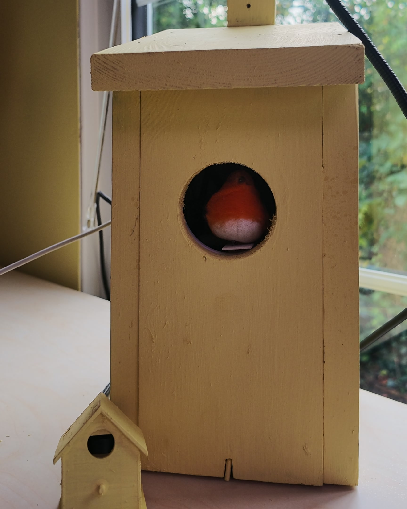
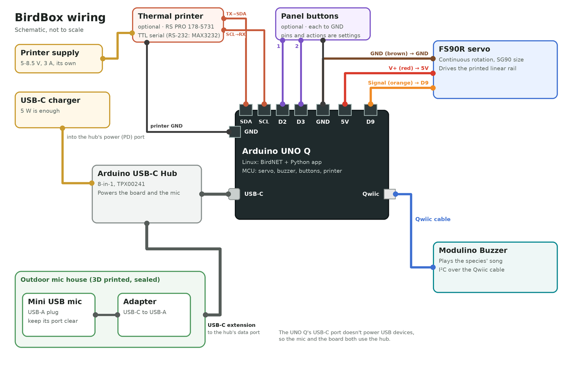
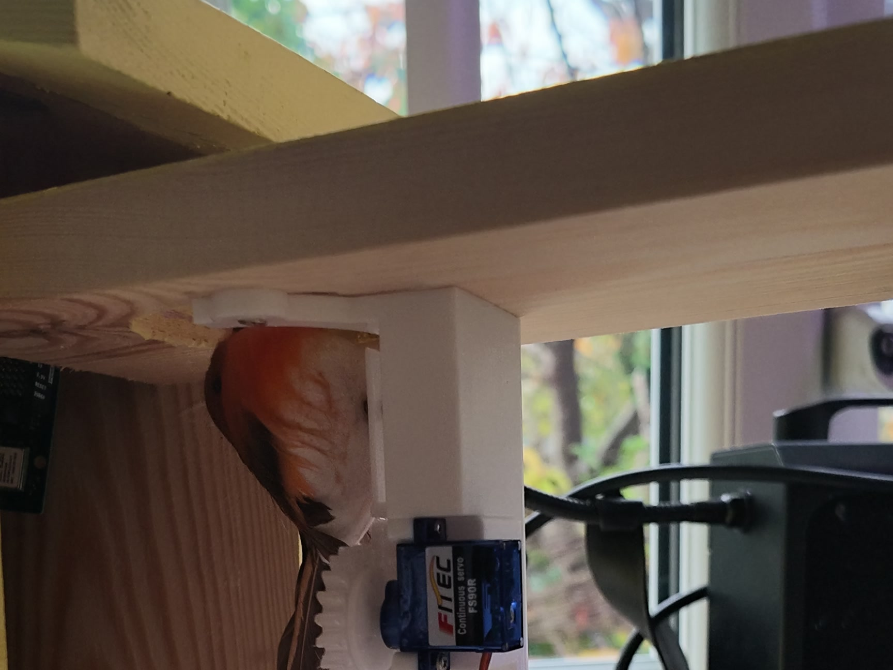
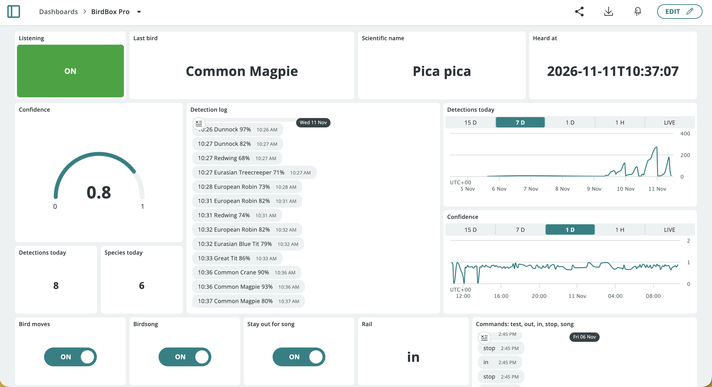
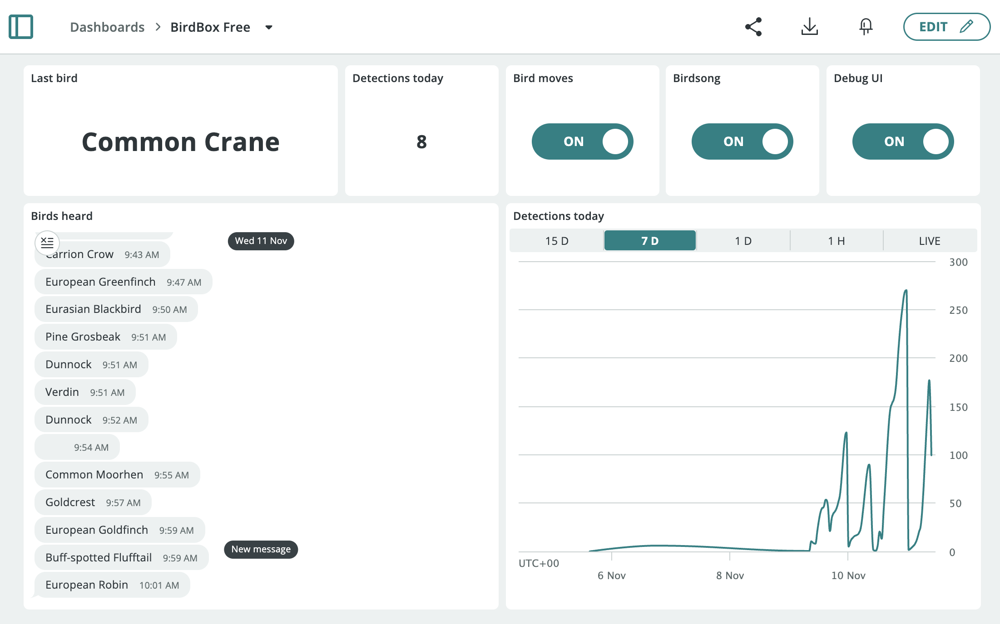
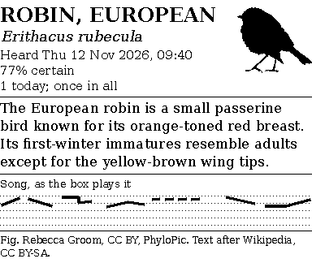
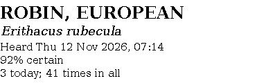
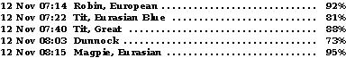
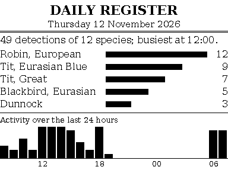
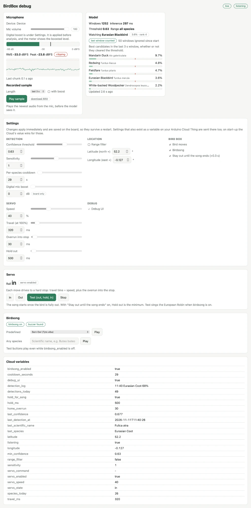

# 🐦 BirdBox



A smart bird box for the **Arduino UNO Q**. It listens through a microphone,
identifies bird species on-device with **BirdNET GLOBAL 6K V2.4** (6522 classes),
and publishes every detection to **Arduino Cloud**. When it hears a bird, a felt
bird slides out of the box hole on an **FS90R servo** rail while a **Modulino
Buzzer** plays an approximation of that species' song.

No audio leaves the board. Inference runs locally on the UNO Q's Linux side in
about 225 ms per 3-second window, roughly 13× faster than real time.

```
mic ──► bricks/birdnet ──► Detection ──┬──► Arduino Cloud (results + settings)
     48 kHz mono        BirdNET V2.4   │
     3 s windows        on LiteRT      └──► Router Bridge ──► sketch ──┬──► FS90R servo on D9
                                                                       └──► Modulino Buzzer (Qwiic)
```

| Piece | What it does |
|---|---|
| [`bricks/birdnet/`](bricks/birdnet/) | Custom Brick: microphone capture, 3 s windowing, BirdNET inference, range filter, mute during birdsong |
| [`python/main.py`](python/main.py) | Wires the Brick to Arduino Cloud, the servo, the buzzer and the debug web UI |
| [`python/songs.py`](python/songs.py) | A simulated song for every species, as pitch sweeps the buzzer can play |
| [`sketch/sketch.ino`](sketch/sketch.ino) | MCU side: non-blocking stop-to-stop servo moves and song playback, driven over the Router Bridge |
| [`assets/index.html`](assets/index.html) | Debug web UI on port 7000 (mic meter, model candidates, servo calibration, song tester) |
| [`docs/arduino-cloud.md`](docs/arduino-cloud.md) | Step-by-step Arduino Cloud Thing and dashboard setup |
| [`docs/project-hub.md`](docs/project-hub.md) | Arduino Project Hub write-up |
| [`hardware/`](hardware/) | 3D-printable outdoor mic holder, linear servo assembly and servo gear (STL + STEP) |
| [`tools/`](tools/) | Arduino Cloud API scripts that create the Thing variables and the Free and Pro dashboards |
| [`python/receipts.py`](python/receipts.py), [`printer.py`](python/printer.py), [`birdinfo.py`](python/birdinfo.py), [`history.py`](python/history.py) | Optional thermal printer: receipt layouts, ESC/POS output, silhouettes and descriptions, and the detection log |

## What you need

| Part | Notes |
|---|---|
| Arduino UNO Q | 2 GB or 4 GB. Connected to Wi-Fi and to Arduino App Lab. |
| [Mini USB Microphone](https://thepihut.com/products/mini-usb-microphone) (The Pi Hut) | Tiny USB-A mic that fits the printed outdoor holder. Any USB mic works. An analog mic also works on the 3.5 mm **TRRS** jack of the UNO Media Carrier (ASX00083), but it must be a 4-pole headset plug (CTIA); a plain TS/TRS lavalier plug only records noise. |
| [UGREEN USB-C to USB-A adapter](https://www.amazon.co.uk/UGREEN-Adapter-10Gbps-iPhone-MacBook-Grey/dp/B0B9N3QSL3) | Goes in the mic holder with the mic. |
| [UGREEN USB-C extension cable](https://www.amazon.co.uk/UGREEN-Extension-Extender-Compatible-Thunderbolt/dp/B08NTCD6VQ) | Runs from the mic holder outside to the board indoors. |
| [Arduino USB-C Hub (8-in-1)](https://store.arduino.cc/products/usb-c-hub-8-in-1) (TPX00241) | Powers the UNO Q through its USB-C power passthrough, and the mic through its data port. Needed because the UNO Q's USB-C port doesn't supply power to USB devices. |
| FS90R continuous-rotation micro servo | Same body as an SG90, so it fits the printed assembly. Driven directly from D9, no driver board. |
| Modulino Buzzer + Qwiic cable | Optional. Without it everything works and birdsong is silent. |
| [RS PRO thermal panel printer](https://uk.rs-online.com/web/p/panel-printers/1785731) (RS 178-5731) | Optional. 58 mm paper, 384 dots per line. Connects to the MCU's serial pins (D0/D1). Needs its **own 5–8.5 V, 3 A supply**, and a MAX3232 level-shifter module if its serial port is RS-232. See [Thermal printer and buttons](#thermal-printer-and-buttons-optional). |
| 1–2 panel-mount push buttons | Optional, for printing a bird card and the daily summary. |
| A wooden bird box | A real one. You'll cut a second, larger hole in it for the bird. |
| A small bird | A felt robin is ideal. Pick whatever bird suits you. |
| 3D-printed parts | Mic holder, linear servo assembly and servo gear — see [Building the hardware](#building-the-hardware). |
| ~60 mm hole saw, small wood screws, silicone sealant or hot glue | For mounting and weatherproofing. |
| USB-C power supply | Plugs into the hub's power port and powers everything. A basic 5 W charger is enough. |
| Arduino Cloud account | The app uses 32 Thing variables (24 without the printer). The Free plan allows 5 per Thing, and there's a ready-made Free dashboard — see [Arduino Cloud plans](docs/arduino-cloud.md#which-plan-you-need). |

## Wiring



| From | To |
|---|---|
| FS90R orange / yellow (signal) | **D9** |
| FS90R red (V+) | **5V** |
| FS90R brown / black (GND) | **GND** |
| Modulino Buzzer | **Qwiic** connector |
| Button 1, optional (prints the bird card by default) | **D2** and **GND** |
| Button 2, optional (prints the daily summary by default) | **D3** and **GND** |
| Thermal printer RX, optional | **D1** (MCU TX), through a MAX3232 if the printer is RS-232 |
| Thermal printer TX, optional | **D0** (MCU RX), for status replies; optional |
| Thermal printer GND | **GND** (shared ground for the serial link) |
| Thermal printer power | Its own 5–8.5 V, 3 A supply |
| USB-C hub | Hub's USB-C plug → UNO Q's USB-C port; power supply → hub's **power** port |
| Microphone | Mic → USB-C adapter → USB-C extension cable → hub's USB-C **data** port |

> **Why the hub?** The UNO Q's USB-C port only *takes* power: it never supplies
> 5 V to what's plugged into it, even when the board runs from VIN. A USB mic
> plugged straight into the board, or through a plain adapter, gets no power and
> never shows up. The Arduino USB-C Hub fixes that and powers the board through its
> passthrough at the same time, so nothing needs to go on VIN.

## Building the hardware

The print files are in [`hardware/`](hardware/), as STL for printing and STEP
for editing.

| File | What it is |
|---|---|
| `birdbox-mic-holder.stl` / `.step` | A small outdoor housing for the mic and its USB-C adapter |
| `birdbox-servo-assembly-print-in-place.stl` | The linear servo assembly, printed in one piece |
| `birdbox-servo-assembly.step` | The servo assembly as an editable model |
| `servo-gear.stl` / `.step` | The pinion gear that goes on the servo |

### Outdoor microphone

The mic has to be outside to hear birds well. The board stays indoors.

1. Print the mic holder.
2. Plug the Mini USB Microphone into the USB-C to USB-A adapter, then plug the
   adapter into the USB-C extension cable.
3. Put the mic and adapter in the holder, with the cable coming out of the back.
4. Fill the holder with silicone sealant or hot glue to waterproof it.
   **Keep the microphone's sound port clear** — cover it with tape while you fill
   and remove it afterwards. A blocked port means a deaf box.
5. Mount the holder outside, somewhere sheltered from rain and wind, and run the
   cable indoors to the USB-C data port on the hub.

Use the debug UI's **Recorded sample** to check the mic still hears clearly once
it's sealed.

### Servo assembly and bird



The linear servo assembly is based on
[Linear servo using SG90 9g servo](https://www.printables.com/model/1566678-linear-servo-using-sg90-9g-servo) by
**lingeswaran** on Printables (CC BY). The servo gear is from that design too.

1. **Print the assembly** print-in-place: put the **mounting face on the build
   plate** and use **organic supports**. Then print the **servo gear**.
2. **Fit the gear** to the FS90R's output shaft with the servo's screw, or glue it.
3. **Mount the servo** in the assembly so the gear meshes with the rack.
4. **Cut the bird hole.** Use a ~60 mm hole saw on the front of a real bird box,
   big enough for your bird to pass through. Keep the original entrance hole if
   you want real birds to move in.
5. **Attach the bird** to the end of the assembly's arm.
6. **Screw the assembly inside the box** so that the bird sits just inside the
   hole when retracted, and pokes out when the servo drives out.
7. Wire the servo to the UNO Q (see [Wiring](#wiring)), start the app, and
   [calibrate the rail](#calibrating-the-rail). The assembly's ends act as the hard
   stops the app relies on.

If the bird goes in when it should come out, flip `OUT_SIGN` (see [Calibrating the rail](#calibrating-the-rail)).

## Install

On the board (App Lab terminal, SSH or `adb shell`):

```bash
cd ~/ArduinoApps
git clone https://github.com/jimbruges/birdbox.git birdbox
```

The app then shows up under **My Apps** in Arduino App Lab. Before starting it,
set up Arduino Cloud.

## Arduino Cloud setup

| BirdBox Pro | BirdBox Free |
|---|---|
|  |  |

The short version — the full walkthrough, with every variable's type, permission
and recommended widget, is in **[docs/arduino-cloud.md](docs/arduino-cloud.md)**:

1. **Connect the board:** App Lab → **Settings → Arduino Cloud → Connect device**.
   Wait for **Connected**.
2. **Open the board's Thing** at [app.arduino.cc/things](https://app.arduino.cc/things).
3. **Add the 24 variables** listed below, or let `tools/setup_cloud.py` create them through the API ([quick setup](docs/arduino-cloud.md#quick-setup-with-the-api)). Names must match exactly — check the
   **Declaration** field shows the same name.
4. **Build the dashboard** from the layout in the guide.
5. **Start the app.** Any variable with no Cloud value yet is seeded from the
   board's current value on first connect.

**On the Free plan (5 variables per Thing)?** Create only `last_species`,
`detections_today`, `servo_enabled`, `birdsong_enabled` and `debug_ui` (the
**BirdBox Free** dashboard uses exactly these), then set everything else in the debug UI's **Settings** card. Settings are saved on the
board (`data/settings.json`) and survive restarts. Every variable below is optional.

### Settings — permission _Read & Write_ (Cloud → board)

| Variable | Cloud type | Range | Default | What it does |
|---|---|---|---|---|
| `min_confidence` | Floating Point Number | `0.01`–`0.99` | `0.5` | Score a species must reach to count as detected. Clamped. |
| `sensitivity` | Floating Point Number | `0.5`–`1.5` | `1.0` | Steepness of BirdNET's score curve. See [Tuning detection](#tuning-detection). Clamped. |
| `cooldown_seconds` | Integer Number | `0`+ | `30` | Quiet period **per species**. `0` reports every window; `300` gives at most one blackbird every 5 min. |
| `range_filter` | Boolean | | `false` | Restricts BirdNET to species plausible at `latitude`/`longitude` and the time of year. |
| `latitude` | Floating Point Number | `-90`–`90` | `0.0` | Decimal degrees, **north** positive. Cambridge UK is `52.2053`. |
| `longitude` | Floating Point Number | `-180`–`180` | `0.0` | Decimal degrees, **east** positive. Cambridge UK is `0.1218`, New York `-74.0060`. |
| `servo_enabled` | Boolean | | `true` | Master switch for the servo. Detections still reach the Cloud when off. |
| `birdsong_enabled` | Boolean | | `true` | Plays a simulated song for each detected species on the Modulino Buzzer. |
| `hold_for_song` | Boolean | | `true` | Keeps the bird out until its song has finished, plus 0.3 s. |
| `travel_ms` | Integer Number | `50`–`3000` | `320` | Stop-to-stop travel time, expressed at 100% speed. The main calibration value. |
| `servo_speed` | Integer Number | `10`–`100` | `40` | Percent of full speed. A move takes `travel_ms × 100 / servo_speed + home_overrun`. |
| `home_overrun` | Integer Number | `0`–`1000` | `30` | Extra drive time into each stop, so the rail always seats. |
| `hold_ms` | Integer Number | `0`–`30000` | `500` | How long the bird stays out. With `hold_for_song` on, this is the minimum. |
| `servo_command` | Character String | `in` `out` `test` `stop` `song` | `""` | Test commands from a **Messenger** widget. Cleared by the app after each command. |
| `debug_ui` | Boolean | | `false` | Switches the [debug web UI](#debug-web-ui) on port 7000 on and off. |
| `printer_enabled` | Boolean | | `true` | Master switch for the [printer](#thermal-printer-and-buttons-optional). With no printer attached, prints are skipped. |
| `print_each_detection` | Boolean | | `false` | Prints one compact line per detection, building a scroll. |
| `card_picture` | Boolean | | `true` | PhyloPic silhouette on the bird card. |
| `card_song` | Boolean | | `true` | Vocalisation Chart on the bird card. |
| `card_description` | Boolean | | `true` | Short encyclopaedia entry on the bird card. |
| `card_llm` | Boolean | | `true` | Write that entry with the local LLM (otherwise the first sentence of Wikipedia). |
| `card_credits` | Boolean | | `true` | Print the small picture and text credits on the card. |
| `summary_hour` | Integer Number | `-1`–`23` | `-1` | Prints the daily summary at this hour. `-1` is off. |

`latitude` and `longitude` of exactly `0.0, 0.0` mean "not set", so the range filter
stays off until you enter real coordinates.

### Results — permission _Read Only_ (board → Cloud)

| Variable | Cloud type | Example | Notes |
|---|---|---|---|
| `last_species` | Character String | `Eurasian Blackbird` | Common name, in the `BIRDNET_LOCALE` language. |
| `last_scientific_name` | Character String | `Turdus merula` | Stable across locales. |
| `last_confidence` | Floating Point Number | `0.743` | `0`–`1`, 3 decimals. |
| `last_detection_at` | Character String | `2026-11-05T07:14:22` | ISO 8601, board time (UTC unless you changed the board's timezone). |
| `detections_today` | Integer Number | `47` | Resets at midnight, board time. |
| `species_today` | Integer Number | `9` | Distinct species today. Resets at midnight. |
| `listening` | Boolean | `true` | `true` only while a microphone is open. Your "is it alive" light. |
| `servo_state` | Character String | `in` | `in`, `out`, `moving`, or `unknown` (after a `stop` mid-travel). |
| `detection_log` | Character String | `07:14 European Robin 92%` | One line per detection, for a Messenger widget to show as a running log. |

## First run

Start the app from App Lab, or:

```bash
arduino-app-cli app start ~/ArduinoApps/birdbox
arduino-app-cli app logs ~/ArduinoApps/birdbox --follow
```

The first start downloads ~40 MB into `models/birdnet/` (the FP16 model, the label
set and the range-filter model) and installs `ai-edge-litert`, so give it a few
minutes and an internet connection. Later starts use the cache. You should see:

```
BirdNET:  Microphone connected: ...
BirdNET:  Listening at 48000 Hz, 3s windows, hop 3.00s, threshold 0.50
BirdBox:  Sketch connected, rail in
BirdBox:  Modulino Buzzer found
```

On every boot the sketch drives the rail inwards once, so it always starts at the
inner stop. The app starts without a microphone and checks for one every 10 s, so
you can plug one in or swap it while it runs.

## Calibrating the rail

An FS90R is a **continuous-rotation** servo: the pulse width sets speed and
direction, not an angle, and there is no position feedback. The rail's two hard
stops do the positioning. Every move drives towards one stop for
`travel_ms × 100 / servo_speed + home_overrun` milliseconds, then the servo is
detached so it stops pushing.

The defaults (`travel_ms` 320, `servo_speed` 40, `home_overrun` 30, `hold_ms` 500)
were tuned on the prototype's ~140° rail. For a different rail, use the debug UI's
Servo card or the dashboard's Messenger widget (`servo_command`):

| Command | What it does |
|---|---|
| `out` | Drive to the outer stop. |
| `in` | Drive to the inner stop (`home` works too). |
| `test` | The full detection action: out, sing the European Robin (if `birdsong_enabled`), hold, in. |
| `stop` | Stop immediately. |
| `song` | Play the song only, for the last detected species (the European Robin if nothing has been heard yet). |
| `card` | Print the bird card for the last species heard (with a printer attached). |
| `summary` | Print the daily summary. |
| `line` | Print a scroll line for the last detection. |

1. Set `servo_speed` to how fast you want the bird to move.
2. Send `out`, then `in`. If the bird stops short of a stop, raise `travel_ms`. If
   the servo keeps grinding against the stop, lower `travel_ms` or `home_overrun`.
3. Send `test` and adjust `hold_ms` for how long the bird stays visible.

An FS90R is not linear in speed, so recheck after changing `servo_speed`.

**Rail goes the wrong way?** Flip `const int OUT_SIGN = -1;` to `+1` at the top of
`sketch/sketch.ino`. **Servo creeps when idle?** It shouldn't, since the sketch
detaches it, but you can trim `NEUTRAL_US` (default `1500`) a few µs either way.

**Board resets when the servo moves?** That's the servo's stall current on the 5 V
rail. Try a stronger charger for the hub, or add a bulk capacitor (e.g.
470 µF) across the servo's 5 V and GND.

The built-in LED lights while the bird is moving or out, so you can test the whole chain
— mic → BirdNET → Bridge → MCU — with nothing attached. The sketch logs `Buzzer
found` and `BirdBox servo ready, retracting` to the serial monitor
(`arduino-app-cli monitor`).

## Birdsong

A piezo plays one pitch at a time, so each song is a list of pitch sweeps in
`python/songs.py`. The songs are approximations, not recordings:

1. **70 UK species** have a predefined song: a generated sequence of sweeps, notes
   and trills set to roughly match the species' pitch range and rhythm. They cover
   garden birds (blackbird, great tit, chaffinch, wren…), woodland and farmland
   (woodpeckers, yellowhammer, skylark…), summer visitors (swallow, swift,
   nightingale…), water and coast (mallard, curlew, herring gull…), and raptors and
   owls (red kite, buzzard, tawny owl…).
2. A species **in the same genus** as one of those borrows its song, re-pitched and
   re-timed, so it sounds similar but not identical.
3. **Anything else** gets a song generated from its scientific name — a trill,
   whistle, chirps, warble or sweeps. The same species always sounds the same.

The log says which: `Playing birdsong for Turdus merula once the bird is out
(curated, 2.4 s)`. Add or change a song in the `CURATED` table; the helpers `note`,
`sweep`, `rest`, `trill`, `run`, `drum`, `warble` and `harsh` keep each one short.

With the servo on, the song starts once the bird reaches the outer stop, and (with
`hold_for_song`) the bird retracts only after the song ends.

**The box doesn't answer itself.** BirdNET keeps analysing during a song, but any
3-second window that overlaps the song is not reported. The quiet period runs from
when the song is sent, through the bird's out move, to the end of the song plus
0.5 s (`BIRDSONG_MUTE_TAIL_S` in `python/main.py`).

## Thermal printer and buttons (optional)

BirdBox can print onto 58 mm thermal paper, styled like an entry in an old
encyclopaedia. Everything here is optional: with no printer or buttons connected the
box works as before, and every receipt can still be previewed on the
[debug page](#debug-web-ui), at exactly the size it would print.

| Bird card (button 1) | Minimal card | Scroll | Daily summary (button 2) |
|---|---|---|---|
|  |  |  |  |
| 38 mm | 15 mm | 1.6 mm a line | 36 mm (example data) |

### What it prints

- **Bird card** (button 1, or `card`). For the last species heard: the name, the
  scientific name, when it was heard, how sure BirdNET was, and how many times it's
  been heard today and in total. Optionally, each switchable from the dashboard:
  - a silhouette from [PhyloPic](https://www.phylopic.org/), beside the text so it
    costs no extra paper, with the artist and licence credited
  - a short encyclopaedia entry (see below), credited to Wikipedia. It's fitted to at
    most five lines and always ends on a complete sentence.
  - a **Vocalisation Chart**: the buzzer song for the species as pitch (1–8 kHz, log
    scale) against time
  - a one-line credit for the picture and text, in small type (`card_credits`).
    Many PhyloPic images are CC BY, which requires credit, so leave it on if you
    share prints.
- **Scroll** (`print_each_detection`). One line per detection, with the date, time,
  species and confidence in 10 px bold (about 1.6 mm a line), and no gap between
  lines, so the paper builds into a list of the day's birds. **Scroll line text size**
  on the debug page goes down to 9 px.
- **Daily summary** (button 2, `summary`, or automatically at `summary_hour`). The
  day's detections and species, the top five species, and activity over the last 24
  hours.

Every detection is logged to SQLite (`data/birdbox.db`) for the counts and the
summary. Silhouettes and descriptions are fetched in the background the first time a
species is heard, and cached in `data/birdinfo/`, so a button press prints straight
away.

### Encyclopaedia entries from the local LLM

The bird card's entry is written on the board by the `arduino:llm` brick (Qwen 3.5
0.8B on a UNO Q):

- The model is given the introduction of the species' Wikipedia article and asked to
  condense it into two sentences, adding nothing.
- Each reply is checked against that text. If it uses words the source doesn't
  contain, it's rejected and the card falls back to the article's first sentence.
- An entry takes 30–100 s, so each species keeps one cached entry. A print uses it
  straight away and a new one is written for next time, focusing on something else
  (plumage, range, food or behaviour), so cards don't repeat word for word.
- The debug page's Printer card shows the last prompt, reply and grounding score.

The model needs about 480 MB of RAM, which fits alongside BirdNET on a 2 GB UNO Q.
To run without it, remove `arduino:llm` from `app.yaml` or switch off `card_llm`;
cards then use the first sentence of Wikipedia.

### Connecting it

**Printer, on the MCU's serial pins.** The RS PRO 178-5731 is an SPRT SP-RMD9
panel printer; its manual covers the commands and settings. The sketch streams each
receipt out of `Serial1`, the UNO Q's hardware serial port:

| SP-RMD9 serial pin (5-pin / 10-pin socket) | UNO Q |
|---|---|
| RXD, data in (3 / 3) | **D1** (TX) |
| TXD, data out (2 / 2), optional | **D0** (RX). Lets the app check the printer is there. |
| CTS, busy (4 / 8), optional | A free pin such as **D4**, set as *Busy (CTS) pin* |
| GND (5 / 5) | **GND** |
| Power | Its own 5–8.5 V, 3 A supply, never the board's 5V pin |

- **Logic levels:** the UNO Q's pins are 3.3 V. The SP-RMD9's serial port comes as
  RS-232 (EIA, ±12 V) or TTL depending on the model. A TTL port connects directly; an
  RS-232 one needs a MAX3232 level-shifter module, or it can damage the pins. The
  printer's self-test page says which interface it has.
- **Image command:** the SP-RMD9 prints images with `ESC K` (8-dot-tall bit-image
  lines) and doesn't understand ESC/POS `GS v 0`, so **Image command** defaults to
  `ESC K`. For other printers, try the image tests on the debug page.
- **Speed:** the printer ships at 9600 baud, 8N1. To change it, hold **LF** while
  powering on, release after three flashes, step through the settings with **SEL**,
  change values with **LF**, and save with **LF** then **SEL** (see the manual). Set
  **Serial speed** on the debug page to match. At 9600 a 37 mm card takes about 15 s
  to send; at 115200 about a second.
- **Busy line and pacing:** the printer has a 3 KB buffer and prints at up to
  30 mm/s, slower on dark images. If data arrives faster than it prints, the buffer
  overflows and the rest of the receipt prints as garbage. Two guards, which work
  together:
  - wire its CTS to a free pin (D4 on the prototype) and set **Busy (CTS) pin**; the
    sketch pauses while it's busy, and the Printer card shows the line's live state
  - **Print speed** (default 10 mm/s) limits how fast image data is sent. Slower
    printing also comes out darker and more even. Set it to 0 to rely on the busy
    line alone.
- **Print quality:** a thermal head can only heat so many dots in one row, so the
  receipts avoid long solid runs: rules are 2-dot dashes, and bars and the
  Vocalisation Chart are drawn in a 2×2-block grey. The head also needs current for
  dark areas. If prints are faint or
  patchy, use a supply towards the top of the 5–8.5 V range, slow **Print speed**, or
  raise *Printing Density* in the printer's setup menu.
- **Print direction:** the factory setting is *Reverse*, so receipts read the right
  way up as they come out of the panel.
- **Power-up text:** USART1 on D0/D1 is also the MCU's boot console, so a short line
  of boot text may print when the board restarts. Each receipt starts with a printer
  reset, so it doesn't affect later prints.
- **USB printers** work too: set **Connected to** to *USB on the hub*, and the app
  finds `/dev/usb/lp0` or `/dev/ttyACM0`.

The sketch buffers 4 KB and feeds the UART from `loop()`, so printing never stalls
the servo or the buzzer.

**Buttons.** Wire each button between a digital pin and **GND**; the sketch uses
the internal pull-ups, and a pin with nothing connected never triggers. Both the
pins and what each button does are settings on the debug page's **Buttons** group:

| Button | Default pin | Default action | Actions |
|---|---|---|---|
| 1 | **D2** | Print the bird card | bird card, daily summary, scroll line, test the bird (out, song, in), play the last bird's song, nothing |
| 2 | **D3** | Print the daily summary | same |

Pins D2–D8 and D10–D13 are free. D0/D1 belong to the printer and D9 to the servo.
Set a button's pin to *Not used* to turn it off.

The plan and the ideas tested along the way are in
[docs/plan-v2-printer.md](docs/plan-v2-printer.md).

## Debug web UI



Switch on `debug_ui` in Arduino Cloud, then open `http://<board-ip>:7000`. The page
shows:

- **Microphone:** device, ALSA volume, live RMS/peak meter with
  clipping warning, level history, and a **3-second recording** you can play back or
  download to check what the mic hears.
- **Model:** the best five candidates from the last window
  (whether or not they cleared the threshold), the score of one watched species
  (`BIRDNET_WATCH_SPECIES`), and whether the last window was muted for birdsong.
- **Settings:** every setting in one place — detection, location, bird box and
  servo calibration — plus the board-only digital mic boost. Changes apply
  immediately, are saved on the board, and are sent to Arduino Cloud for variables
  your Thing defines. On start-up, the Cloud's value wins for those.
- **Servo:** rail state and In / Out / Test / Stop.
- **Printer:** preview the bird card, daily summary and scroll line exactly as they'd
  print, with their length in mm, and print them; plus the printer's status and the
  local LLM's last prompt and reply.
- **Birdsong:** buzzer status, and buttons to play any predefined song or any species
  by scientific name (works even while `birdsong_enabled` is off).
- **Cloud variables:** every variable the app registers and its current value.

While `debug_ui` is off, the page and its API answer 503 and do nothing. The UI has
no login: anyone on your network can move the servo while it's on, so switch it off
when you're done.

## Tuning detection

- **Implausible species (frogs, tropical birds)?** Turn on `range_filter` with your
  coordinates first. It narrows 6522 classes to the few hundred plausible at your
  location and time of year (Cambridge UK in November → 139 species) and is far more
  selective than raising the threshold.
- **Too few detections?** Lower `min_confidence` towards `0.3`. Below ~0.3 a
  6522-class model starts inventing birds.
- **Cloud flooded during the dawn chorus?** Raise `cooldown_seconds` to 120–300.
- **Calls cut off at window edges?** Set `BIRDNET_OVERLAP_SECONDS` to `1.0`.
- **Quiet mic?** Raise **Digital mic boost** in the debug UI's Settings.

**How `sensitivity` works:** BirdNET's score is `sigmoid(sensitivity × logit)`, so
it changes which detections clear `min_confidence` only when the threshold is not
`0.5`. With a threshold **below** 0.5, a **lower** sensitivity gives more
detections; **above** 0.5, a **higher** sensitivity does. At exactly 0.5 it only
changes the reported confidence.

## Brick Configuration

Set in **App Lab → the app → Brick Configuration** (the `birdnet` brick). These are
read at startup, so restart the app after changing one. Those marked ↻ are only
first-run defaults: once the setting has been changed from the Cloud or the debug
UI, the saved value takes over.

| Variable | Default | What it does |
|---|---|---|
| `BIRDNET_MIC_DEVICE` | `auto` | Which mic to open. `auto` takes the first free one, USB first. Otherwise an index (`0`), an ALSA name (`plughw:CARD=Device,DEV=0`), or `usb:1` / `usb:2` / `jack:1`. |
| `BIRDNET_MIN_CONFIDENCE` ↻ | `0.5` | Starting threshold. |
| `BIRDNET_SENSITIVITY` ↻ | `1.0` | Starting sensitivity. |
| `BIRDNET_COOLDOWN_SECONDS` ↻ | `30` | Starting per-species quiet period. |
| `BIRDNET_LATITUDE` / `BIRDNET_LONGITUDE` ↻ | `0` | Range-filter location used until the Cloud's `range_filter` settings arrive. Both must be non-zero. |
| `BIRDNET_BIRDS_ONLY` | `true` | Drops BirdNET's 13 non-bird classes (Dog, Siren, Engine, Human vocal, Noise…). |
| `BIRDNET_GAIN_DB` ↻ | `0` | Digital boost, 0–30 dB, before analysis. The debug UI's setting overrides it. |
| `BIRDNET_WATCH_SPECIES` | `Eurasian Blackbird` | Common name of one species the debug UI always scores. |
| `BIRDNET_LOCALE` | `en_uk` | Language of `last_species`: `en_us`, `de`, `fr`, `es`, `it`, `nl`, `pt`, `sv`, `fi`… An unknown value falls back to `en_uk`. |
| `BIRDNET_OVERLAP_SECONDS` | `0.0` | Overlap between windows, 0–2.5 s. `1.0` costs 1.5× the CPU. |
| `BIRDNET_THREADS` | `2` | Inference threads, 1–4. Measured: 1 → 351 ms, 2 → 251 ms, 4 → 225 ms per window. |
| `BIRDNET_MODEL_VARIANT` | `FP16` | `FP32` is twice the size and no faster here. Hidden. |
| `BIRDNET_MODEL_DIR` | `/app/models/birdnet` | Model cache. Hidden. |

## Using the Brick on its own

```python
from birdnet import BirdNET
from arduino.app_utils import App

birds = BirdNET(min_confidence=0.6)
birds.on_detection(lambda d: print(d))
birds.on_detect("Eurasian Wren", lambda d: print("wren!"))

App.run()
```

## Licensing

This project's code is licensed under the [Mozilla Public License 2.0](LICENSE).
The 3D print files in `hardware/` are licensed under
[CC BY 4.0](https://creativecommons.org/licenses/by/4.0/). They're adapted from
[Linear servo using SG90 9g servo](https://www.printables.com/model/1566678-linear-servo-using-sg90-9g-servo) by lingeswaran (CC BY): the servo
assembly is a modified version, and the servo gear is the original part.

The BirdNET model and labels are **not included** in this repository; the Brick
downloads them from the
[BirdNET-Analyzer](https://github.com/birdnet-team/BirdNET-Analyzer) repository on
first run. The BirdNET-Analyzer code is MIT, but the **model weights are
CC BY-NC-SA 4.0** (attribution, non-commercial, share-alike). Educational and
research use is fine; a commercial product or paid service needs a separate
agreement with the Cornell Lab of Ornithology.

Model: Kahl, S., Wood, C.M., Eibl, M., Klinck, H. *BirdNET: A deep learning solution
for avian diversity monitoring.* Ecological Informatics 61 (2021).
