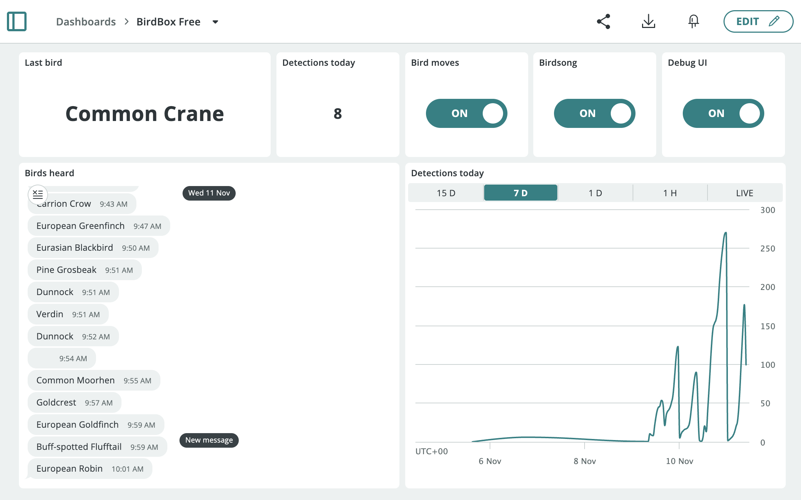
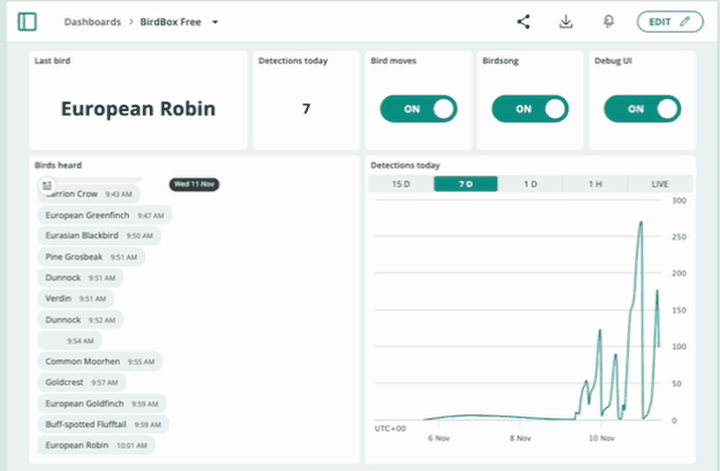
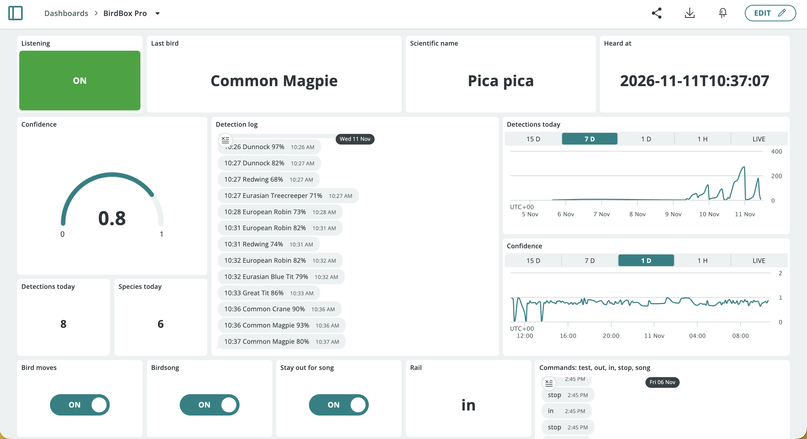
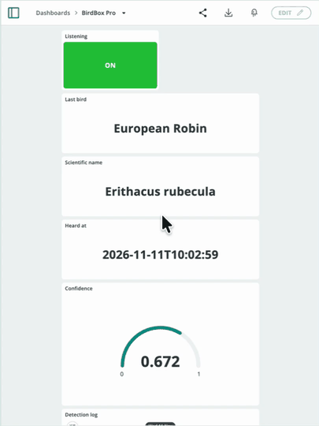

# Arduino Cloud setup

This guide connects the UNO Q to Arduino Cloud, creates the Thing variables the app
syncs, and builds a dashboard to watch detections and tune the bird box. There are
two ready-made dashboards: **BirdBox Free**, which fits the Free plan, and
**BirdBox Pro**, which uses every variable. A script can create the variables and
both dashboards for you ([quick setup](#quick-setup-with-the-api)), or you can do
it by hand (steps 3 and 4).

The app doesn't need Cloud credentials in its code or configuration. The board's
**arduino-cloud-connector** service owns the connection, and the app's
`arduino:arduino_cloud` brick talks to it locally.

## Which plan you need

The app registers **32 variables** (24 without the optional printer). On the [Arduino Cloud plans](https://cloud.arduino.cc/plans/)
page, the **Free** plan allows **5 variables per Thing**; **Maker** and above are
unlimited.

Every variable is optional. The [debug web UI](../README.md#debug-web-ui) can change
every setting, and saves it on the board (`data/settings.json`), so a variable
only needs to be on the Thing if you want it on your dashboard. On the Free plan,
create these five, which the **BirdBox Free** dashboard uses:

| Variable | Why |
|---|---|
| `last_species` | What it last heard, plus a running list of birds in a Messenger widget |
| `detections_today` | How busy the garden has been, as a number and a chart (1 day of history on Free) |
| `servo_enabled` | Stop the bird moving |
| `birdsong_enabled` | Silence the buzzer, e.g. at night |
| `debug_ui` | Lets you turn on the debug web UI, which covers calibration and tuning |

Then switch on `debug_ui`, open `http://<board-ip>:7000`, and set the location,
thresholds and servo calibration in the page's **Settings** card. They're saved on
the board and survive restarts. Settings that are also on the Thing are sent to
the Cloud too.

## 1. Connect the board

1. Open **Arduino App Lab** connected to your UNO Q.
2. Go to **Settings → Arduino Cloud → Connect device**.
3. Sign in, choose the Cloud space, and wait for the status to show **Connected**.

Starting an app that uses the Cloud brick on an unconnected board opens a
**Provisioning required** dialog leading to the same flow.

## 2. Open the board's Thing

Go to [app.arduino.cc/things](https://app.arduino.cc/things) and open the Thing your
UNO Q is associated with. If there isn't one, create a Thing and associate the board
with it under **Associated Device**.

## Quick setup with the API

`tools/setup_cloud.py` creates the variables and both dashboards through the
[Arduino Cloud API](https://docs.arduino.cc/arduino-cloud/api/api-overview/). Do
steps 1 and 2 first, then:

1. **Create an API key** at [app.arduino.cc/api-keys](https://app.arduino.cc/api-keys).
   Copy the Client ID and Client Secret; the secret is only shown once.
2. **Save it on the board.** This prompts for each value, hides the secret as you
   type, and saves to `~/.config/arduino-cloud/credentials.json`, readable only by
   you. Leave the Space ID blank unless the Thing is in a shared space.

   ```bash
   mkdir -p ~/.config/arduino-cloud && chmod 700 ~/.config/arduino-cloud && read -rp "Client ID: " CID && read -rsp "Client secret: " CSECRET && echo && read -rp "Space ID (blank for personal space): " ORG && umask 077 && printf '{"client_id": "%s", "client_secret": "%s", "org_id": "%s"}\n' "$CID" "$CSECRET" "$ORG" > ~/.config/arduino-cloud/credentials.json && unset CSECRET && echo "Saved"
   ```

3. **Find your Thing's name**, then preview the changes. `plan` only reads:

   ```bash
   cd ~/ArduinoApps/birdbox
   python3 tools/arduino_cloud.py things
   python3 tools/setup_cloud.py plan --thing "<thing name>"
   ```

4. **Create the variables.** Add `--free` to create only the five Free-plan
   variables, and `--delete-legacy` to remove ones from older versions of the app:

   ```bash
   python3 tools/setup_cloud.py thing --thing "<thing name>"
   ```

5. **Create the dashboards.** On the Free plan, add `--free` for just BirdBox Free.
   Running it again replaces the dashboards' widgets, so it's safe to repeat:

   ```bash
   python3 tools/setup_cloud.py dashboards --thing "<thing name>"
   ```

6. Start, or restart, the app.

The variables and layouts live in `tools/setup_cloud.py`, if you want to change
them. `tools/arduino_cloud.py` is a small helper for other API calls (`things`,
`props <thing id>`, `dashboards`, `get <path>`).

## 3. Add the variables

For each row, click **ADD** in the Thing's **Cloud Variables** panel and fill in:

- **Name:** exactly as below — lower case, with underscores. After typing it, check
  that the **Declaration** line underneath shows the same name. The app matches on
  this name, and a variable whose name differs never syncs. Nothing reports the
  mismatch.
- **Type:** from the basic types list.
- **Permission:** as listed.
- **Update policy:** **On change**.

You don't need to set initial values. The first time the app connects, any variable
with no Cloud value yet gets the board's current value (its saved setting, or the
default).

### Settings — Read & Write

| Name | Type | Default | Range |
|---|---|---|---|
| `min_confidence` | Floating Point Number | `0.5` | 0.01 – 0.99 |
| `sensitivity` | Floating Point Number | `1.0` | 0.5 – 1.5 |
| `cooldown_seconds` | Integer Number | `30` | 0 and up |
| `range_filter` | Boolean | `false` | |
| `latitude` | Floating Point Number | `0.0` | −90 – 90, north positive |
| `longitude` | Floating Point Number | `0.0` | −180 – 180, east positive |
| `servo_enabled` | Boolean | `true` | |
| `birdsong_enabled` | Boolean | `true` | |
| `hold_for_song` | Boolean | `true` | |
| `travel_ms` | Integer Number | `320` | 50 – 3000 |
| `servo_speed` | Integer Number | `40` | 10 – 100 |
| `home_overrun` | Integer Number | `30` | 0 – 1000 |
| `hold_ms` | Integer Number | `500` | 0 – 30000 |
| `servo_command` | Character String | `""` | `in`, `out`, `test`, `stop`, `song`, `card`, `summary`, `line` |
| `debug_ui` | Boolean | `false` | |
| `printer_enabled` | Boolean | `true` | |
| `print_each_detection` | Boolean | `false` | |
| `card_picture` | Boolean | `true` | |
| `card_song` | Boolean | `true` | |
| `card_description` | Boolean | `true` | |
| `card_llm` | Boolean | `true` | |
| `card_credits` | Boolean | `true` | |
| `summary_hour` | Integer Number | `-1` | −1 (off) – 23 |

Out-of-range values are clamped by the app.

### Results — Read Only

| Name | Type |
|---|---|
| `last_species` | Character String |
| `last_scientific_name` | Character String |
| `last_confidence` | Floating Point Number |
| `last_detection_at` | Character String |
| `detections_today` | Integer Number |
| `species_today` | Integer Number |
| `listening` | Boolean |
| `servo_state` | Character String |
| `detection_log` | Character String |

Making results **Read Only** stops a dashboard widget overwriting them.
`detection_log` gets one line per detection, like `07:14 European Robin 92%`, so a
Messenger widget bound to it shows a running log.

### Check your location

`latitude` is the **north–south** number and comes first. Cambridge, UK is latitude
`52.2053`, longitude `0.1218`. If you enter them the wrong way round, the range
filter ends up in the Indian Ocean and drops almost every species you'll actually
hear. `0.0, 0.0` means "not set" and leaves the filter off.

### Upgrading from an earlier version

If your Thing has `sweep_enabled`, `out_position` or `servo_position`, delete them.
The current app doesn't use them.

## 4. Build the dashboards

Create a dashboard at [app.arduino.cc/dashboards](https://app.arduino.cc/dashboards)
and add widgets with **ADD**, linking each to its variable. These are the layouts
`tools/setup_cloud.py` builds.

### BirdBox Free



Switching the bird off and on again from the dashboard:



| Widget | Variable | Settings |
|---|---|---|
| **Value** | `last_species` | "Last bird" |
| **Value** | `detections_today` | |
| **Switch** | `servo_enabled` | "Bird moves" |
| **Switch** | `birdsong_enabled` | "Birdsong" |
| **Switch** | `debug_ui` | "Debug UI" |
| **Messenger** | `last_species` | "Birds heard": a running list of each new species |
| **Chart** | `detections_today` | The day's activity |

### BirdBox Pro





| Section | Widget | Variable | Settings |
|---|---|---|---|
| Now | **Status** | `listening` | Mode On / Off |
| Now | **Value** | `last_species` | |
| Now | **Value** | `last_scientific_name` | |
| Now | **Value** | `last_detection_at` | |
| Today | **Gauge** | `last_confidence` | Min `0`, max `1` |
| Today | **Messenger** | `detection_log` | Running log of every detection |
| Today | **Chart** | `detections_today` | |
| Today | **Chart** | `last_confidence` | |
| Today | **Value** | `detections_today`, `species_today` | |
| Bird box | **Switch** | `servo_enabled`, `birdsong_enabled`, `hold_for_song` | |
| Bird box | **Value** | `servo_state` | |
| Bird box | **Messenger** | `servo_command` | Type `test`, `out`, `in`, `stop` or `song` |
| Detection | **Value** (editable) | `min_confidence`, `sensitivity` | 2 decimals |
| Detection | **Slider** | `cooldown_seconds` | Min `0`, max `600` |
| Detection | **Switch** | `range_filter` | |
| Detection | **Value** (editable) | `latitude`, `longitude` | 4 decimals |
| Calibration | **Slider** | `servo_speed` | Min `10`, max `100` |
| Calibration | **Slider** | `travel_ms` | Min `50`, max `1500` |
| Calibration | **Stepper** | `home_overrun` | Min `0`, max `200`, step `10` |
| Calibration | **Slider** | `hold_ms` | Min `0`, max `10000` |
| Calibration | **Switch** | `debug_ui` | |
| Printer | **Switch** | `printer_enabled`, `print_each_detection` | |
| Printer | **Slider** | `summary_hour` | Min `-1`, max `23` |
| Printer | **Switch** | `card_picture`, `card_song`, `card_description`, `card_llm`, `card_credits` | |

The script also sets a phone layout for each dashboard, keeping the same order with
small widgets two to a row.

Widgets bound to Read & Write variables are editable. Widgets bound to Read Only
variables only display.

## 5. Check it

Start the app and watch the log:

```bash
arduino-app-cli app logs ~/ArduinoApps/birdbox --follow
```

Flip a switch on the dashboard. Each setting logs a line when it arrives, e.g.:

```
BirdBox:  Birdsong disabled
BirdBox:  Servo speed set to 40%
```

Then type `test` in the Messenger widget. The bird should come out, sing, and go
back in, and `servo_state` should go `moving` → `out` → `moving` → `in`.

If a switch does nothing:

- **Check the variable name.** Compare the Declaration with the tables above.
- **Check the permission.** A Read Only setting can't be written from the dashboard.
- **Check the board is online.** The device status on the Thing page should be
  **Online**, and `listening` should be `true`.
- **Re-send the same value?** Cloud only sends changes. `servo_command` clears
  itself after each command so you can repeat one, but a Switch already on can't be
  turned on again.

## How sync works

- **Settings** are saved on the board whenever they change, from either the Cloud
  or the debug UI. For a variable the Thing defines, the brick's default
  `CLOUD_WINS` policy applies on start-up: the Cloud's stored value replaces the
  saved one. A variable with no Cloud value yet is seeded from the saved value.
- **Results** use `DEVICE_WINS`. On reconnect the board's live values replace
  whatever the Cloud last held.
- A live change from the dashboard is always applied immediately, whatever the
  policy.
