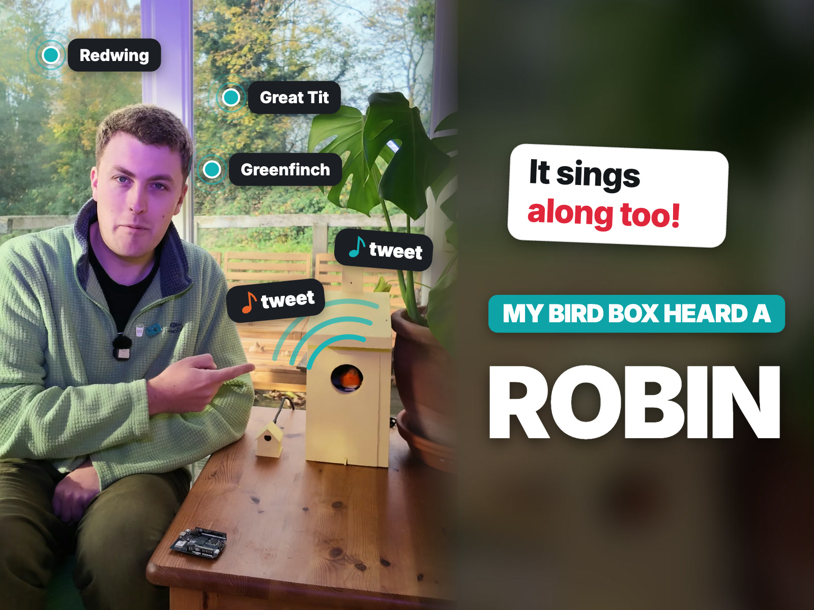
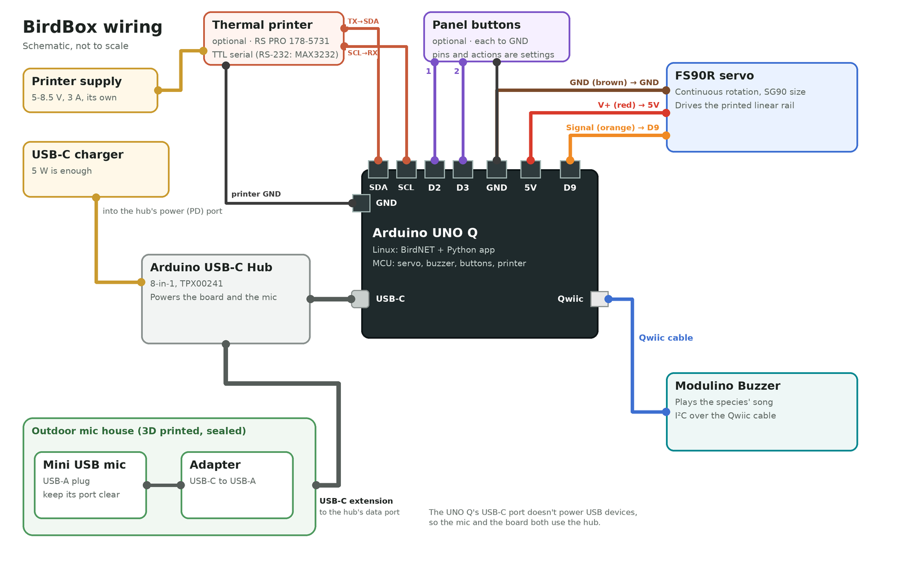
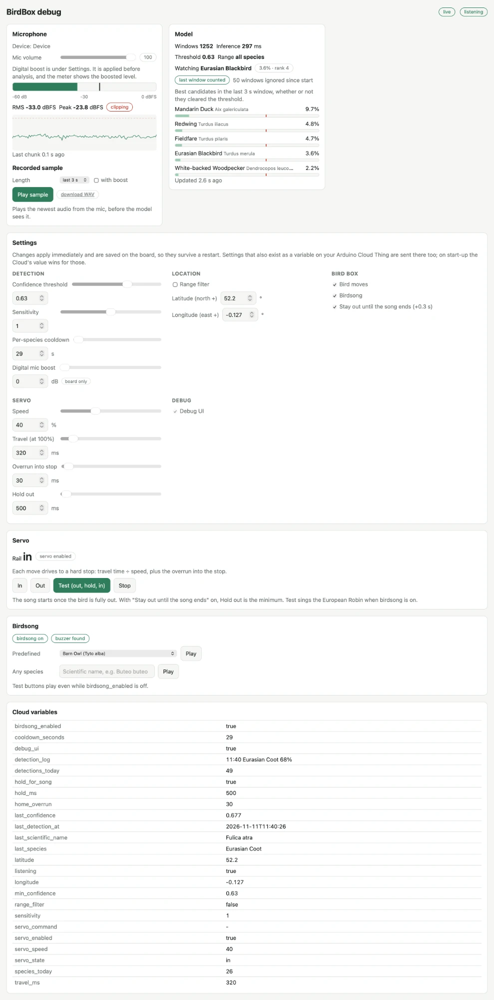
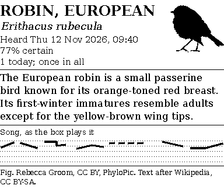
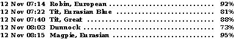
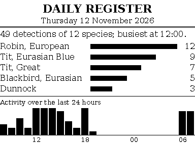

# Project Hub draft — BirdBox

Copy each section into the matching field of the Project Hub editor. Replace each
`[PHOTO: …]` or `[VIDEO: …]` placeholder with your own media. Images referenced
here are in the repository's `docs/images/` folder; upload them to Project Hub where
they appear.

The write-up is in two stages. Stage 1 is the listening bird box, released as
[v1.0](https://github.com/jimbruges/birdbox/releases/tag/v1.0). Stage 2 adds a
thermal printer and buttons, and is optional.

---

## Cover image



`docs/images/cover_robin_4x3.jpg` (1600 × 1200, 4:3). A PNG version is alongside it.

## Title

**BirdBox: On-Device Bird Identification with the Arduino UNO Q**

## Short description

A bird box that identifies birds on-device with BirdNET, logs them to Arduino Cloud,
moves a felt bird out while a buzzer plays the species' song, and prints
encyclopaedia-style notes on a thermal printer.

## Tags

`uno-q` · `app-lab` · `birdnet` · `machine-learning` · `audio` · `arduino-cloud` ·
`servo` · `modulino` · `thermal-printer` · `llm` · `wildlife` · `edge-ai`

## Difficulty / time

Intermediate · stage 1 about 3 hours, stage 2 about 2 hours, plus printing time

## Components and supplies

**Stage 1: the listening bird box**

| Qty | Item |
|---|---|
| 1 | Arduino UNO Q (2 GB or 4 GB) |
| 1 | [Mini USB Microphone](https://thepihut.com/products/mini-usb-microphone) (The Pi Hut) |
| 1 | [UGREEN USB-C to USB-A adapter](https://www.amazon.co.uk/UGREEN-Adapter-10Gbps-iPhone-MacBook-Grey/dp/B0B9N3QSL3) |
| 1 | [UGREEN USB-C extension cable](https://www.amazon.co.uk/UGREEN-Extension-Extender-Compatible-Thunderbolt/dp/B08NTCD6VQ) |
| 1 | [Arduino USB-C Hub (8-in-1)](https://store.arduino.cc/products/usb-c-hub-8-in-1) |
| 1 | FS90R continuous-rotation micro servo (SG90 size) |
| 1 | Arduino Modulino Buzzer + Qwiic cable |
| 1 | USB-C power supply, 5 W is enough (powers the hub and the board) |
| 1 | Wooden bird box |
| 1 | Small felt bird (I used a robin) |
| 3 | Jumper wires (servo to D9, 5V and GND) |
| — | 3D-printed mic holder, linear servo assembly and servo gear |
| — | Silicone sealant or hot glue, small wood screws |

**Stage 2: printed field notes (optional)**

| Qty | Item |
|---|---|
| 1 | [RS PRO thermal panel printer](https://uk.rs-online.com/web/p/panel-printers/1785731) (RS 178-5731, an SPRT SP-RMD9) |
| 1 | 5–8.5 V, 3 A power supply for the printer |
| 1 | 58 mm thermal paper roll |
| 2 | Panel-mount momentary push buttons |
| 1 | MAX3232 level-shifter module, only if the printer's serial port is RS-232 |
| 6 | Jumper wires (printer RX, TX, CTS and GND; buttons) |

## Tools

- 3D printer
- ~60 mm hole saw and drill
- Saw or router for the printer's 103 × 57 mm panel cutout (stage 2)
- Hot glue gun (if not using silicone)
- Screwdriver

## Apps and platforms

- Arduino App Lab
- Arduino Cloud
- BirdNET-Analyzer (model, CC BY-NC-SA 4.0)
- Arduino LLM brick with Qwen 3.5 0.8B (stage 2)
- PhyloPic and Wikipedia (stage 2, for the bird cards)

---

## Story


### The idea

Bird-ID apps on a phone are great, but you have to be holding the phone at the
moment a bird sings. I wanted a box that sits in the garden and listens all day,
tells me who visited, and responds when a bird calls: a felt bird comes out of
the hole and the box plays a song for that species.

The **Arduino UNO Q** suits this well. Its Linux side runs Cornell's **BirdNET**
model in real time, with no cloud inference and no audio leaving the garden. Its
real-time microcontroller drives the servo and buzzer. Arduino App Lab ties the two
together, and Arduino Cloud gives me a dashboard on my phone.

Once that worked, I added a second stage: a thermal printer and two buttons in the
base of the box, so it can print a note about the last bird it heard, a running
scroll of every bird, and a summary of the day.

[VIDEO: a bird calls, the model bird slides out, sings, and retracts]

### How it works

```
microphone ─► BirdNET brick (Linux) ─► detection ─┬─► Arduino Cloud dashboard
                                                   ├─► SQLite log ─► receipts ─┐
                                                   └─► Router Bridge ─► MCU ─┬─┴► thermal printer
                                                                             ├─► servo pushes bird out
                                                                             ├─► buzzer plays the species' song
                                                                             └─◄ buttons
```

1. **Listen.** A custom App Lab *brick* records 48 kHz audio from the microphone in
   3-second windows.
2. **Identify.** Each window goes through BirdNET GLOBAL 6K V2.4 (6,522 classes)
   with LiteRT. It takes about 225 ms on the UNO Q, about 13× faster than real time.
   An optional range filter keeps only species plausible at your location and time
   of year.
3. **Report.** Detections above a confidence threshold go to Arduino Cloud: species,
   confidence, time, and daily counts.
4. **Perform.** The Python app tells the microcontroller over the Router Bridge to
   push the bird out. Once it reaches the end of the rail, the Modulino Buzzer plays
   a song for that species. The bird retracts when the song ends.
5. **Print (stage 2).** Every detection is logged. A button, a schedule or each new
   detection prints a receipt, which the microcontroller streams to the printer.

---

## Stage 1: the listening bird box

### 3D-printed parts

All the print files (STL, plus STEP for remixing) are in the repository's
`hardware/` folder:

- **Mic holder** — a small outdoor housing for the USB mic and its adapter
- **Linear servo assembly** — print-in-place rack and slide for an SG90-size servo
- **Servo gear** — the pinion that drives the rack

The servo assembly is based on
[Linear servo using SG90 9g servo](https://www.printables.com/model/1566678-linear-servo-using-sg90-9g-servo) by lingeswaran on Printables, and the
servo gear comes from that design, used under CC BY.

**Printing the servo assembly:** it's print-in-place, so put the **mounting face on
the build plate** and use **organic supports**.


### Building the outdoor microphone


The board lives indoors, but the microphone needs to be outside to hear birds
properly.

1. Plug the Mini USB Microphone into the USB-C to USB-A adapter, and the adapter
   into the USB-C extension cable.
2. Fit the mic and adapter into the printed holder.
3. Fill the holder with silicone or hot glue to waterproof it. **Don't block the
   microphone's sound port** — a piece of tape over it while you fill does the job.
4. Mount it somewhere sheltered outside, and run the cable in to the USB-C data port
   on the hub.

Record a test sample from the debug page afterwards to check the mic still hears
clearly.

### Building the servo bird box

| | |
|---|---|
|  |  |
|  |  |


1. **Fit the gear** onto the FS90R's shaft. Screw it on with the servo's screw, or
   glue it.
2. **Mount the servo** in the printed assembly so the gear meshes with the rack.
3. **Cut a hole** in the front of a real bird box with a ~60 mm hole saw, big
   enough for your bird to pass through. I used a felt robin; pick a bird that
   suits you.
4. **Attach the bird** to the end of the assembly's arm.
5. **Screw the assembly inside the box** so the bird hides just behind the hole
   when retracted and pokes out when the servo drives.

An FS90R is a continuous-rotation servo, which spins rather than moving to an
angle. So the ends of the assembly's travel act as **hard stops**: the sketch drives
towards one end for a fixed time plus a small overrun, then releases the servo. No
encoder or homing switch is needed, and the bird can't drift out of calibration.

| | |
|---|---|
|  |  |


### Wiring



| From | To |
|---|---|
| Servo signal (orange) | D9 |
| Servo V+ (red) | 5V |
| Servo GND (brown) | GND |
| Modulino Buzzer | Qwiic connector |
| USB-C hub | UNO Q's USB-C port (power supply in the hub's power port) |
| Microphone | USB-C adapter → USB-C extension → hub's USB-C data port |

The diagram also shows the stage 2 printer and buttons.

> **Mic tip:** the Media Carrier's 3.5 mm jack is a combined headset socket. It
> needs a 4-pole TRRS (CTIA) plug, like phone headsets. A plain lavalier plug with
> one or two bands will only record noise. A cheap USB microphone avoids the
> question entirely.

> **Power tip:** the UNO Q's USB-C port doesn't supply power to USB devices, even
> when the board is powered from VIN. I first tried plugging the mic straight in
> and it never appeared. The Arduino USB-C Hub (8-in-1) solves this: a small
> charger in the hub's power port powers the board through the passthrough, and
> the mic plugs into the hub's data port.

### Software

The whole project is one Arduino App. Clone it onto the board:

```bash
cd ~/ArduinoApps
git clone https://github.com/jimbruges/birdbox.git birdbox
```

It shows up in App Lab under **My Apps**. For stage 1 on its own, check out the
`v1.0` tag. The main parts:

- `bricks/birdnet/` — a custom brick wrapping BirdNET. It handles the
  microphone, windowing, inference and the range filter. It downloads the model
  (~40 MB) on first run.
- `python/main.py` — connects detections to Arduino Cloud, the servo, the buzzer
  and the printer, and serves a debug web page.
- `python/songs.py` — the birdsong library.
- `sketch/sketch.ino` — the microcontroller side: non-blocking servo moves, song
  playback, button reading and printer output, controlled over the Router Bridge.

### Birdsong on the buzzer

A piezo buzzer plays one pitch at a time, so each song is a list of pitch sweeps,
played in 10 ms steps. The songs are approximations, not recordings.

- **70 UK species** have a predefined song in `python/songs.py`: a generated
  sequence of sweeps, notes and trills set to roughly match that species' pitch
  range and rhythm.
- A species **in the same genus** as one of those uses its relative's song,
  re-pitched and re-timed.
- **Any other species** gets a song generated from its scientific name, so it's
  the same every time.

A box that plays bird calls next to a microphone listening for bird calls would
detect itself. The app tells the BirdNET brick to ignore any audio window that
overlaps its own song, so the box never answers itself.

### Arduino Cloud dashboard


> Upload `docs/images/dashboard-pro-desktop.png`, `dashboard-free-desktop.png` and
> `dashboard-pro-phone-scroll.gif` from the repository to Project Hub here.

Everything is tunable from the dashboard: confidence threshold, cooldown per
species, range filter location, servo speed and timing, birdsong on/off and, with
stage 2, the printer. A Messenger widget sends commands like `test`, `out`, `in` and
`card`.

The repository's `docs/arduino-cloud.md` lists every variable (24 for stage 1, 32
with the printer), and `tools/setup_cloud.py` creates them and two dashboards
through the Arduino Cloud API: **BirdBox Pro**, with a running detection log, and
**BirdBox Free**. On the Free plan (5 variables per Thing), it creates just
`last_species`, `detections_today`, `servo_enabled`, `birdsong_enabled` and
`debug_ui`. You then set everything else from the debug web UI. Settings are saved
on the board, so a Cloud variable is only needed for what you want on your phone.

### Debug web UI



Turning on `debug_ui` from the Cloud opens a page on the board at port 7000 with:

- a live microphone level meter
- a 3-second test recording you can play back in the browser
- BirdNET's top five guesses for every window, even below threshold
- every setting, saved on the board, so the box can be fully set up without
  Cloud variables
- servo test buttons
- a song tester for any species
- with stage 2, receipt previews, printer tests and a demo mode

It made diagnosing a dead microphone much faster than reading logs.

### Calibration

1. Send `out` and `in` from the dashboard or the debug page.
2. If the bird stops short of an end, increase `travel_ms`. If the servo grinds
   against the stop, decrease it.
3. Send `test` to see the whole performance (it always plays the European
   Robin's song), and adjust `hold_ms` to taste.

The defaults (travel 320 ms at 40% speed, 30 ms overrun, 500 ms hold) suit a
140° rail.

---

## Stage 2: printed field notes

[PHOTO: the printer and the two buttons in the base of the box]

The second stage adds an RS PRO thermal panel printer (a rebadged SPRT SP-RMD9) and
two panel buttons to the base of the box. It's optional: without them, the box works
exactly as in stage 1, and every receipt can still be previewed on the debug page.

### What it prints

| Bird card | Scroll | Daily register |
|---|---|---|
|  |  |  |
| about 38 mm | 1.6 mm a line | about 36 mm |

The receipts are styled like an old encyclopaedia: serif type, inverted headwords
("ROBIN, EUROPEAN") and italic scientific names.

- **Bird card** (button 1). The last species heard: name, scientific name, when it
  was heard, how sure BirdNET was, and how many times today and in total. Each of
  these can be switched on or off from the dashboard:
  - a silhouette from [PhyloPic](https://www.phylopic.org/) beside the text, so it
    costs no extra paper
  - a short encyclopaedia entry (below), at most five lines and always ending on a
    complete sentence
  - a **Vocalisation Chart**: the buzzer song as pitch against time
  - a small credit line for the picture and text.
- **Scroll.** With `print_each_detection` on, every detection prints one line with
  the date, time, species and confidence, and no gap between lines, so the paper
  builds up into a list of the day's birds.
- **Daily register** (button 2, or at a set hour). The day's detections and
  species, the top five species, and activity over the last 24 hours.

Everything is designed to use as little paper as possible. Pictures and descriptions
are fetched once per species and cached, so a button press prints straight away.

### Encyclopaedia entries from a local LLM

The card's entry is written on the board by the Arduino LLM brick (Qwen 3.5 0.8B):

- The model is given the introduction of the species' Wikipedia article and asked to
  condense it into two sentences, adding nothing.
- Each reply is checked against that text, and rejected if it uses words the source
  doesn't contain. The card then falls back to the article's first sentence.
- An entry takes 30–100 s, so each species keeps one cached entry. A print uses it
  straight away and a new one is written for next time, with a different focus
  (plumage, range, food or behaviour), so cards don't repeat word for word.

My first attempt asked for a summary of the short Wikipedia blurb. The results were
bland, and one was wrong: "European robin migrates north to winter". Condensing the
full introduction, and checking against it, fixed that. The model uses about 480 MB
of RAM, which fits alongside BirdNET on a 2 GB board.

### Building it in

1. **Cut the printer opening** in the base of the box: the panel cutout is
   103 × 57 mm, with 55 mm of depth behind it.
2. **Mount the two buttons** beside it.
3. **Wire the printer** to the UNO Q's SCL/SDA header pins, which are a spare
   hardware UART (Serial3). Give it its own power supply.

| Printer (5-pin socket) | UNO Q |
|---|---|
| RXD (3) | SCL (D21, TX) |
| TXD (2) | SDA (D20, RX) |
| CTS / busy (4) | D4 |
| GND (5) | GND |
| Power | its own 5–8.5 V, 3 A supply |
| Button 1 | D2 and GND |
| Button 2 | D3 and GND |

The UNO Q's pins are 3.3 V. If your printer's serial port is RS-232 rather than TTL,
put a MAX3232 level shifter in between. The printer's self-test page says which it is.

[VIDEO: timelapse of the scroll building up]

### Getting the printer right

The printer needed more work than anything else, and the debug page's printer tests
came out of it. In case you use a similar panel printer:

- **Its image command is `ESC K`.** It ignores the usual ESC/POS `GS v 0` and prints
  the image bytes as text instead. A plain-text test, then a test pattern in each
  image format, showed which one it understood. The printer's manual confirmed it.
- **It prints in "Reverse" direction by default**, turning each line 180° so text
  reads correctly as it leaves the panel. Image lines are pre-rotated to match, and
  a setting turns the whole receipt round.
- **Don't overrun its 3 KB buffer.** If data arrives faster than it prints, the rest
  of the receipt comes out as garbage. The sketch paces the data (10 mm/s by
  default) and pauses whenever the printer's CTS line says it's busy.
- **Thermal heads limit how many dots heat at once.** Full-width one-dot lines
  vanished, so the rules are 2-dot dashes, and bars and the Vocalisation Chart use a
  2×2-block grey.
- **Keep it off D0/D1.** That UART is also the microcontroller's console, so it
  printed a line of boot text on every reset. The SCL/SDA UART stays silent.
- **Feed.** After a card or register the printer feeds 22 mm, adjustable, so the
  receipt clears the box.

For filming, the debug page has a **demo scroll**. Every few seconds, optionally at
random intervals, a random bird pops out, plays its song and gets a scroll line.
Demo birds aren't logged or sent to the Cloud.

---

### Tips

- **Turn on the range filter** with your coordinates. It cuts 6,522 classes down to
  the ~150 plausible species, and removes the odd "Andean hummingbird" from a noisy
  recording. Latitude comes first: Cambridge, UK is `52.2053, 0.1218`.
- **Raise** `cooldown_seconds` during the dawn chorus so a single bird calling
  repeatedly doesn't flood your dashboard, or your scroll.
- **Power:** a servo stalling against an end stop draws a few hundred mA from the
  5 V rail. If the board resets when the bird moves, try a stronger charger. For
  darker prints, run the printer towards 8.5 V.

### What's next

- A solar panel and battery for a fully off-grid box
- Logging detections to a Cloud chart and comparing seasons
- More predefined songs

### Credits and licence

- **BirdNET** by the K. Lisa Yang Center for Conservation Bioacoustics at the
  Cornell Lab of Ornithology and Chemnitz University of Technology. Model weights
  are CC BY-NC-SA 4.0 (non-commercial). Kahl, S. et al., *BirdNET: A deep learning
  solution for avian diversity monitoring*, Ecological Informatics 61 (2021).
- **Linear servo assembly and servo gear** based on
  [Linear servo using SG90 9g servo](https://www.printables.com/model/1566678-linear-servo-using-sg90-9g-servo) by lingeswaran (CC BY).
- **Bird silhouettes** from [PhyloPic](https://www.phylopic.org/), credited on each
  card with their artist and licence. **Descriptions** after Wikipedia, CC BY-SA.
- This project's code: Mozilla Public License 2.0 (MPL-2.0). 3D print files:
  CC BY 4.0.

---

## Code

Link the repository: <https://github.com/jimbruges/birdbox>. Stage 1 alone is the
[v1.0 release](https://github.com/jimbruges/birdbox/releases/tag/v1.0).

## Schematics

Upload `docs/images/wiring-diagram.png`: servo on D9 / 5V / GND, Modulino Buzzer on
Qwiic, mic and board through the USB-C hub, printer on SCL/SDA with CTS on D4, and
buttons on D2 and D3.
