# Project Hub draft — BirdBox

Copy each section into the matching field of the Project Hub editor. Replace each
`[PHOTO: …]` or `[VIDEO: …]` placeholder with your own media. Images referenced
here are in the repository's `docs/images/` folder; upload them to Project Hub where
they appear.

---

## Cover image

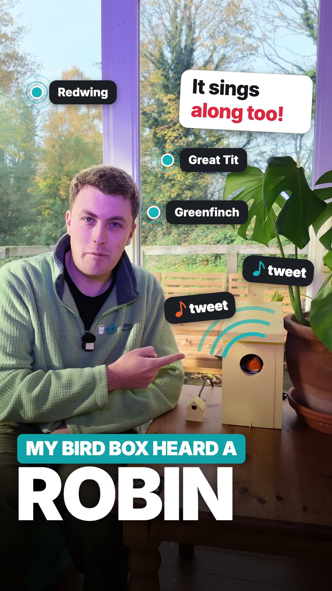

`docs/images/cover_robin.png` (1080 × 1920, portrait).

## Title

**BirdBox: On-Device Bird Identification with the Arduino UNO Q**

## Short description

A bird box that identifies birds on-device with BirdNET (6,522 classes), logs them
to Arduino Cloud, and moves a felt bird out of the box while a buzzer plays an
approximation of that species' song.

## Tags

`uno-q` · `app-lab` · `birdnet` · `machine-learning` · `audio` · `arduino-cloud` ·
`servo` · `modulino` · `wildlife` · `edge-ai`

## Difficulty / time

Intermediate · about 3 hours, plus printing time

## Components and supplies

| Qty | Item |
|---|---|
| 1 | Arduino UNO Q (2 GB or 4 GB) |
| 1 | [Mini USB Microphone](https://thepihut.com/products/mini-usb-microphone) (The Pi Hut) |
| 1 | [UGREEN USB-C to USB-A adapter](https://www.amazon.co.uk/UGREEN-Adapter-10Gbps-iPhone-MacBook-Grey/dp/B0B9N3QSL3) |
| 1 | [UGREEN USB-C extension cable](https://www.amazon.co.uk/UGREEN-Extension-Extender-Compatible-Thunderbolt/dp/B08NTCD6VQ) |
| 1 | [Arduino USB-C Hub (8-in-1)](https://store.arduino.cc/products/usb-c-hub-8-in-1) |
| 1 | FS90R continuous-rotation micro servo (SG90 size) |
| 1 | Arduino Modulino Buzzer + Qwiic cable |
| 1 | USB-C power supply, 5 W is enough (powers the hub and the board) |
| 1 | Wooden bird box |
| 1 | Small felt bird (I used a robin) |
| 3 | Jumper wires (servo to D9, 5V and GND) |
| — | 3D-printed mic holder, linear servo assembly and servo gear |
| — | Silicone sealant or hot glue, small wood screws |

## Tools

- 3D printer
- ~60 mm hole saw and drill
- Hot glue gun (if not using silicone)
- Screwdriver

## Apps and platforms

- Arduino App Lab
- Arduino Cloud
- BirdNET-Analyzer (model, CC BY-NC-SA 4.0)

---

## Story

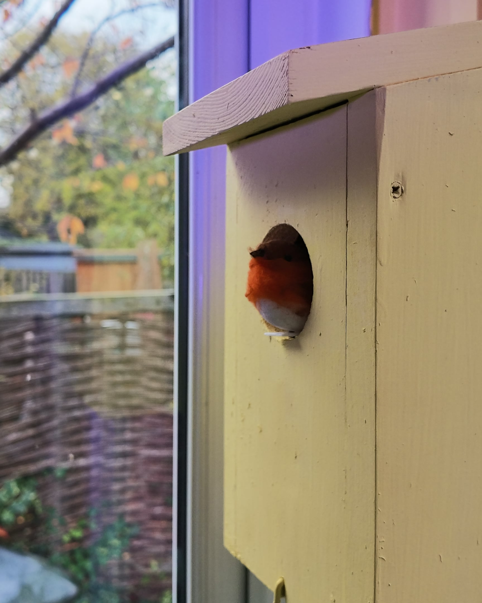

### The idea

Bird-ID apps on a phone are great, but you have to be holding the phone at the
moment a bird sings. I wanted a box that sits in the garden and listens all day,
tells me who visited, and responds when a bird calls: a felt bird comes out of
the hole and the box plays a song for that species.

The **Arduino UNO Q** suits this well. Its Linux side runs Cornell's **BirdNET**
model in real time, with no cloud inference and no audio leaving the garden. Its
real-time microcontroller drives the servo and buzzer. Arduino App Lab ties the two
together, and Arduino Cloud gives me a dashboard on my phone.

[VIDEO: a bird calls, the model bird slides out, sings, and retracts]

### How it works

```
microphone ─► BirdNET brick (Linux) ─► detection ─┬─► Arduino Cloud dashboard
                                                   └─► Router Bridge ─► MCU ─┬─► servo pushes bird out
                                                                             └─► buzzer sings the species
```

1. **Listen.** A custom App Lab *brick* records 48 kHz audio from the microphone in
   3-second windows.
2. **Identify.** Each window goes through BirdNET GLOBAL 6K V2.4 (6,522 classes)
   with LiteRT. It takes about 225 ms on the UNO Q, about 13× faster than real time.
   An optional range filter keeps only species plausible at your location and time
   of year.
3. **Report.** Detections above a confidence threshold go to Arduino Cloud: species,
   confidence, time, and daily counts.
4. **Perform.** The Python app tells the microcontroller over the Router Bridge to
   push the bird out. Once it reaches the end of the rail, the Modulino Buzzer plays
   a song for that species. The bird retracts when the song ends.

### 3D-printed parts

All the print files (STL, plus STEP for remixing) are in the repository's
`hardware/` folder:

- **Mic holder** — a small outdoor housing for the USB mic and its adapter
- **Linear servo assembly** — print-in-place rack and slide for an SG90-size servo
- **Servo gear** — the pinion that drives the rack

The servo assembly is based on
[Linear servo using SG90 9g servo](https://www.printables.com/model/1566678-linear-servo-using-sg90-9g-servo) by lingeswaran on Printables, and the
servo gear comes from that design, used under CC BY.

**Printing the servo assembly:** it's print-in-place, so put the **mounting face on
the build plate** and use **organic supports**.

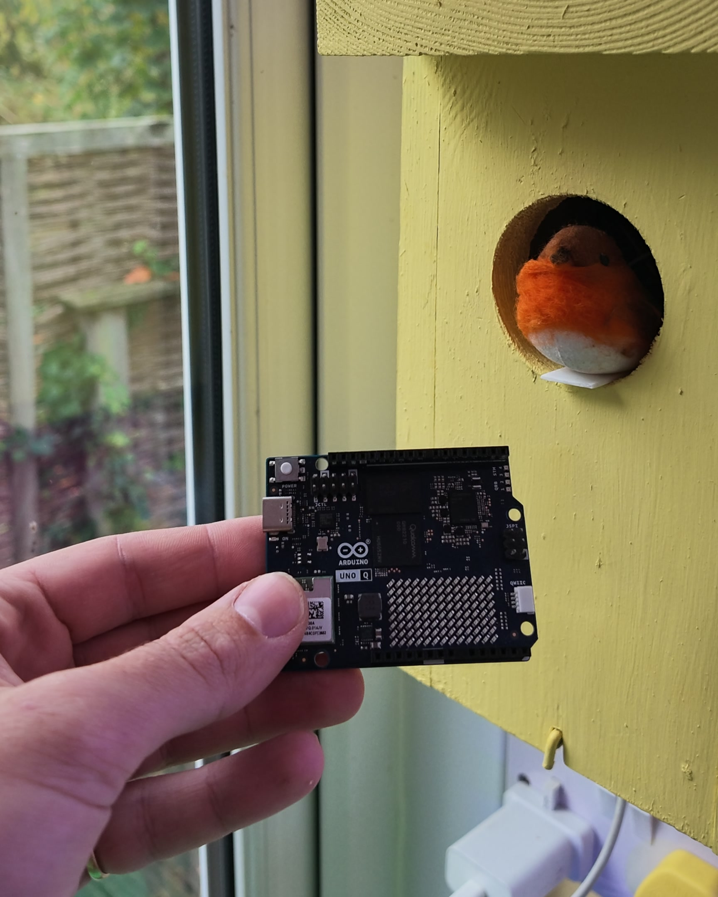

### Building the outdoor microphone

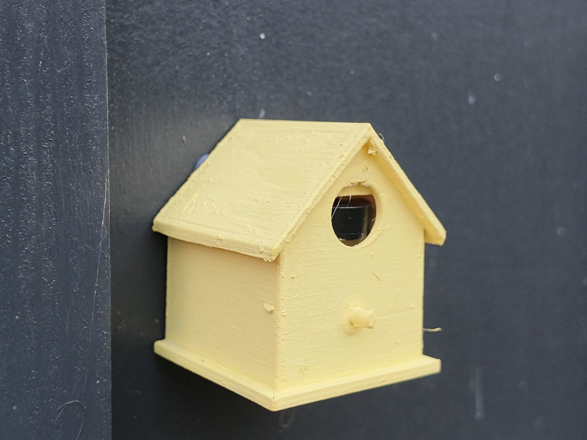

The board lives indoors, but the microphone needs to be outside to hear birds
properly.

1. Plug the Mini USB Microphone into the USB-C to USB-A adapter, and the adapter
   into the USB-C extension cable.
2. Fit the mic and adapter into the printed holder.
3. Fill the holder with silicone or hot glue to waterproof it. **Don't block the
   microphone's sound port** — a piece of tape over it while you fill does the job.
4. Mount it somewhere sheltered outside, and run the cable in to the USB-C data port on
   the UNO Q.

Record a test sample from the debug page afterwards to check the mic still hears
clearly.

### Building the servo bird box

| | |
|---|---|
| 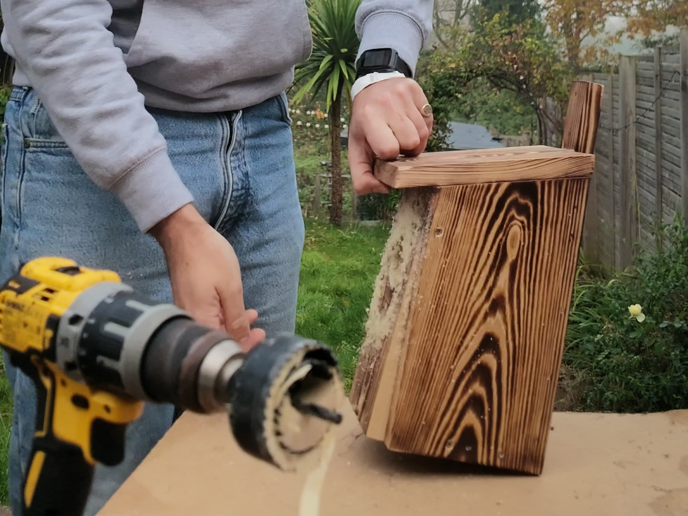 | 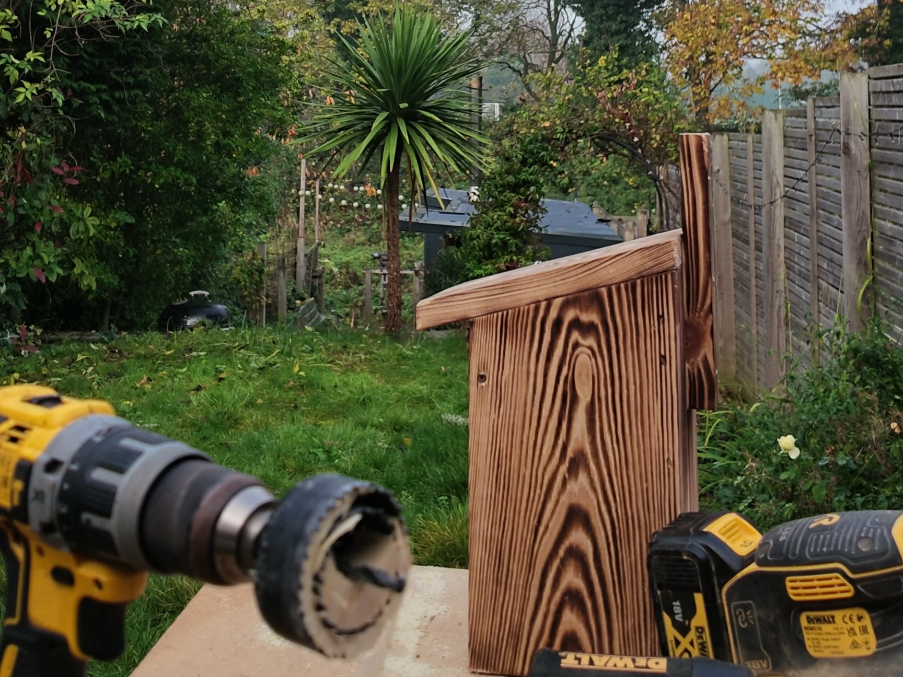 |
| 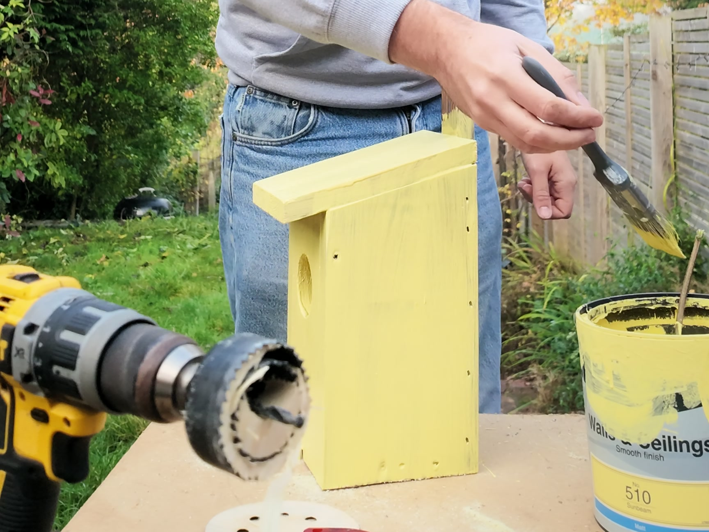 | 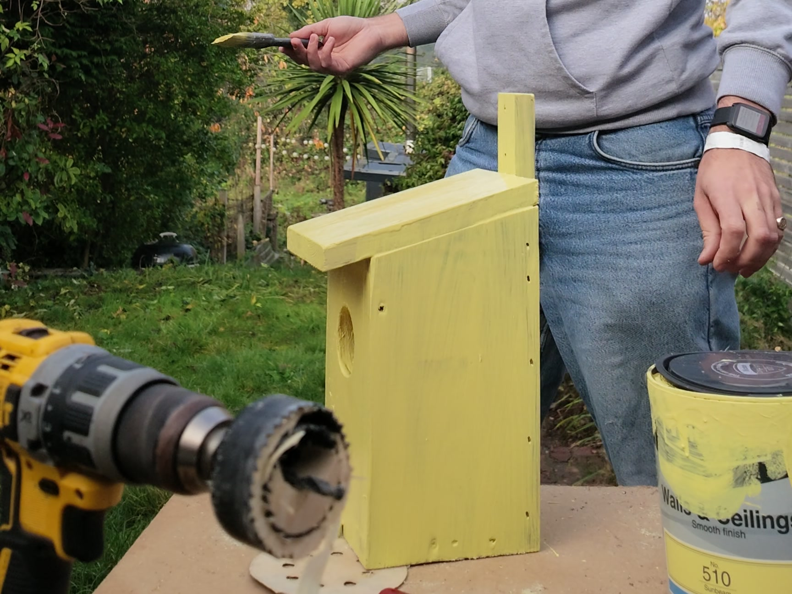 |

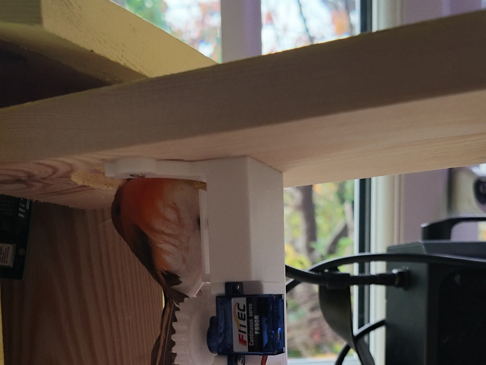

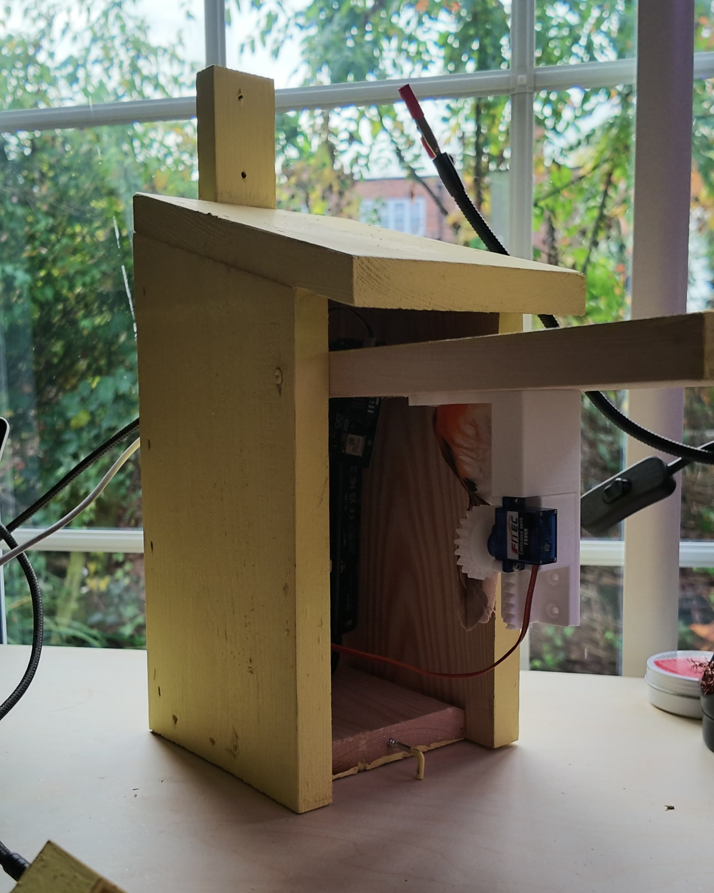

1. **Fit the gear** onto the FS90R's shaft. Screw it on with the servo's screw, or
   glue it.
2. **Mount the servo** in the printed assembly so the gear meshes with the rack.
3. **Cut a hole** in the front of a real bird box with a ~60 mm hole saw, big
   enough for your bird to pass through. I used a felt robin; pick a bird that
   suits you.
4. **Attach the bird** to the end of the assembly's arm.
5. **Screw the assembly inside the box** so the bird hides just behind the hole
   when retracted and pokes out when the servo drives.

An FS90R is a continuous-rotation servo, which spins rather than moving to an
angle. So the ends of the assembly's travel act as **hard stops**: the sketch drives
towards one end for a fixed time plus a small overrun, then releases the servo. No
encoder or homing switch is needed, and the bird can't drift out of calibration.

| | |
|---|---|
| 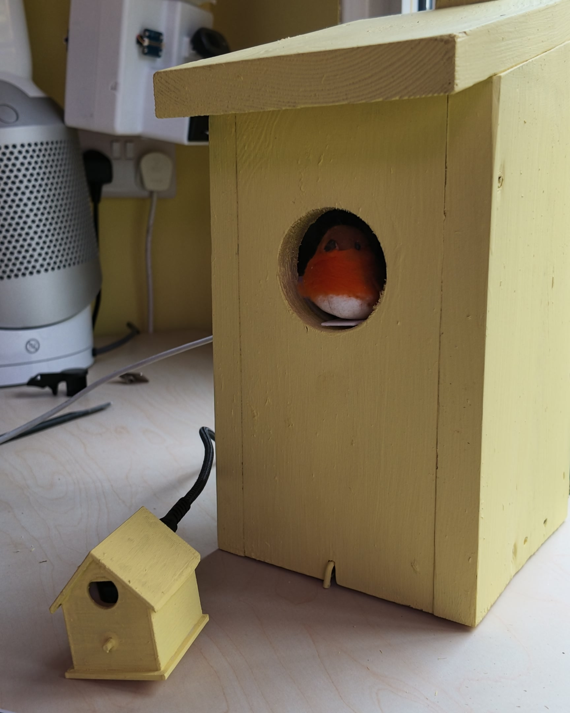 | 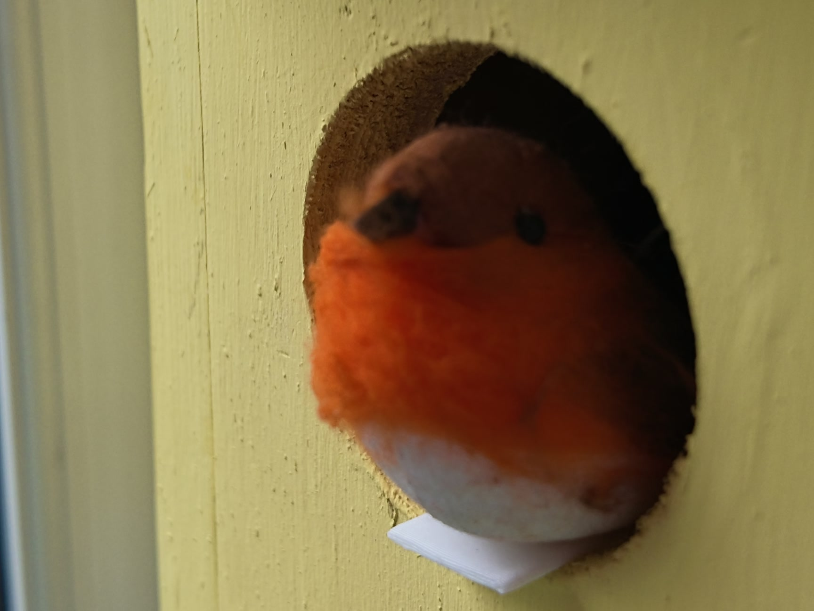 |

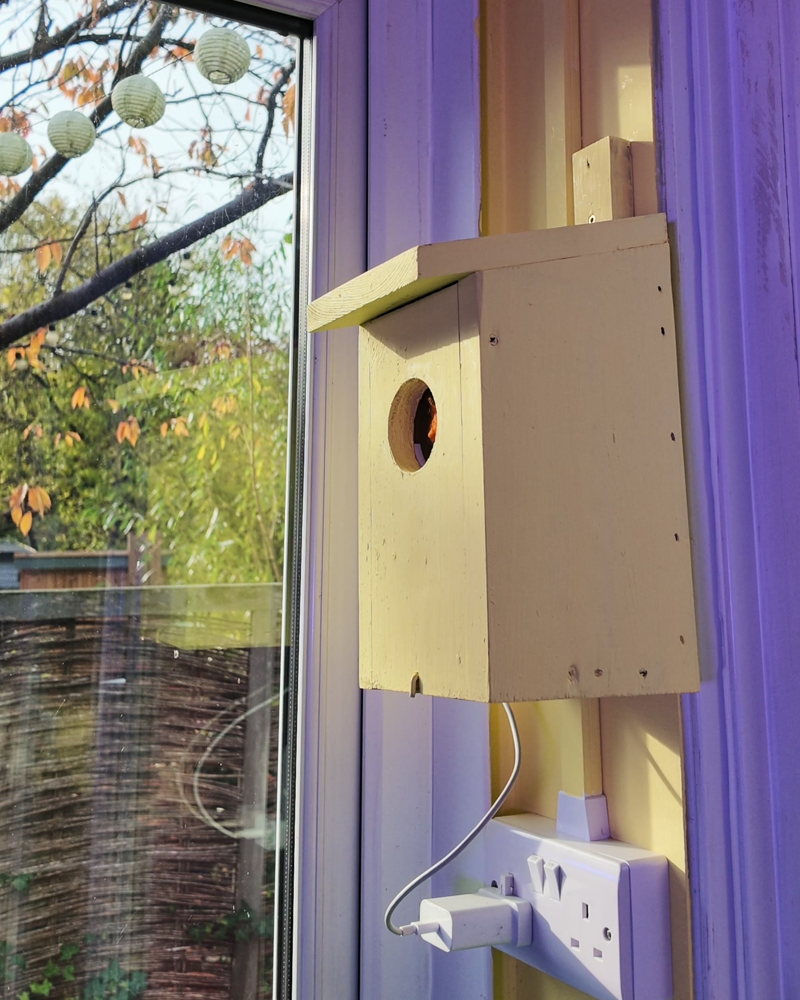

### Wiring

[PHOTO or SCHEMATIC: wiring diagram]

| From | To |
|---|---|
| Servo signal (orange) | D9 |
| Servo V+ (red) | 5V |
| Servo GND (brown) | GND |
| Modulino Buzzer | Qwiic connector |
| USB-C hub | Hub → UNO Q's USB-C port; power supply → hub's power port |
| Microphone | Mic → USB-C adapter → USB-C extension → hub's USB-C data port |

> **Mic tip:** the Media Carrier's 3.5 mm jack is a combined headset socket. It
> needs a 4-pole TRRS (CTIA) plug, like phone headsets. A plain lavalier plug with
> one or two bands will only record noise. A cheap USB microphone avoids the
> question entirely.

> **Power tip:** the UNO Q's USB-C port doesn't supply power to USB devices, even
> when the board is powered from VIN. I first tried plugging the mic straight in
> and it never appeared. The Arduino USB-C Hub (8-in-1) solves this: a small
> charger in the hub's power port powers the board through the passthrough, and
> the mic plugs into the hub's data port.

### Software

The whole project is one Arduino App. Clone it onto the board:

```bash
cd ~/ArduinoApps
git clone https://github.com/jimbruges/birdbox.git birdbox
```

It shows up in App Lab under **My Apps**. The app has four parts:

- **`bricks/birdnet/`** — a custom brick wrapping BirdNET. It handles the
  microphone, windowing, inference and the range filter. It downloads the model
  (~40 MB) on first run.
- **`python/main.py`** — connects detections to Arduino Cloud, the servo and the
  buzzer, and serves a debug web page.
- **`python/songs.py`** — the birdsong library.
- **`sketch/sketch.ino`** — the microcontroller side: non-blocking servo moves and
  song playback, controlled over the Router Bridge.

### Birdsong on the buzzer

A piezo buzzer plays one pitch at a time, so each song is a list of pitch sweeps,
played in 10 ms steps. The songs are approximations, not recordings.

- **70 UK species** have a predefined song in `python/songs.py`: a generated
  sequence of sweeps, notes and trills set to roughly match that species' pitch
  range and rhythm.
- A species **in the same genus** as one of those uses its relative's song,
  re-pitched and re-timed.
- **Any other species** gets a song generated from its scientific name, so it's
  the same every time.

A box that plays bird calls next to a microphone listening for bird calls would
detect itself. The app tells the BirdNET brick to
ignore any audio window that overlaps its own song, so the box never answers itself.

### Arduino Cloud dashboard

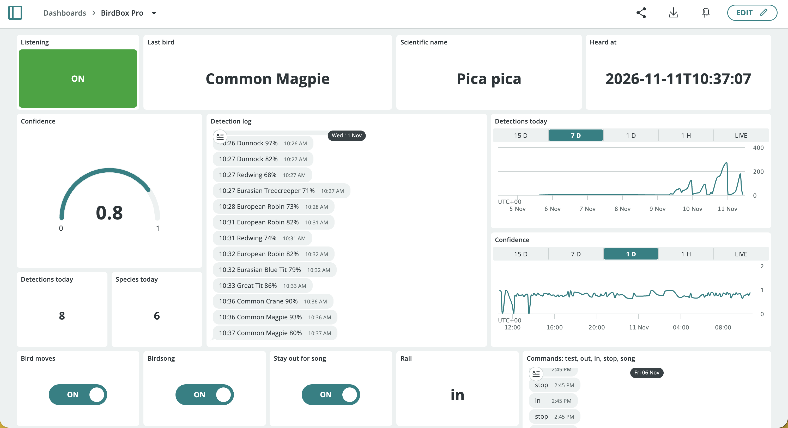

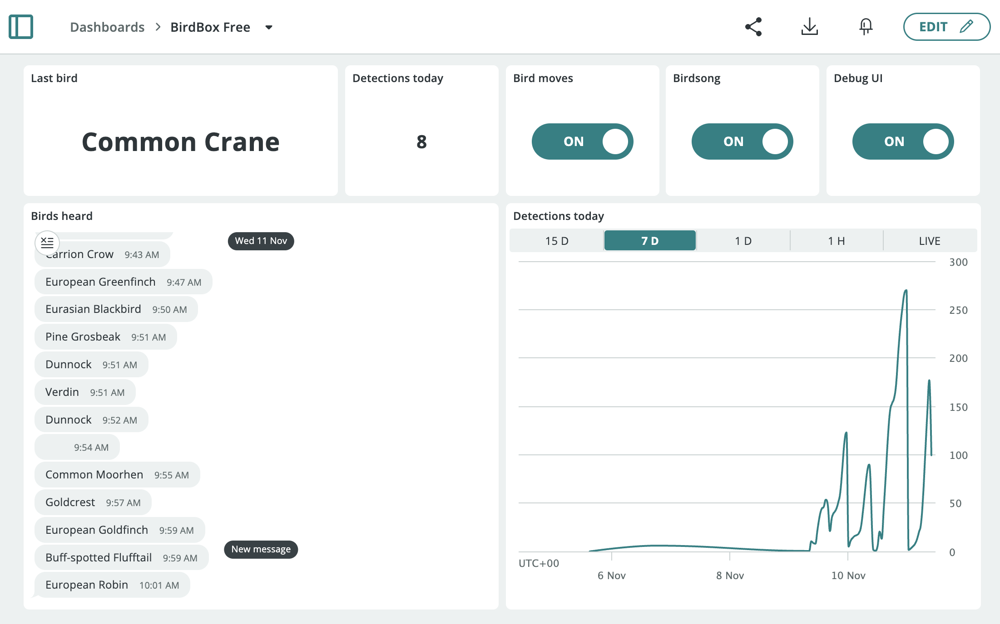

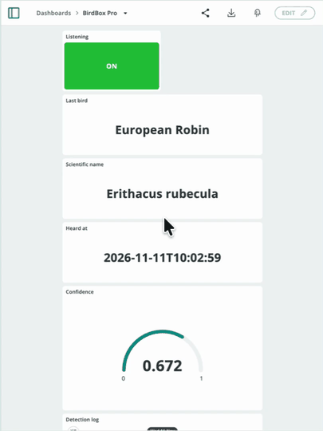

> Upload `docs/images/dashboard-pro-desktop.png`, `dashboard-free-desktop.png` and
> `dashboard-pro-phone-scroll.gif` from the repository to Project Hub here.

Everything is tunable from the dashboard: confidence threshold, cooldown per
species, range filter location, servo speed and timing, and birdsong on/off. A
Messenger widget sends test commands like `test`, `out` and `in` for calibrating
the rail.

The repository's `docs/arduino-cloud.md` lists all 24 variables, and
`tools/setup_cloud.py` creates them and two dashboards through the Arduino Cloud
API: **BirdBox Pro**, with a running detection log, and **BirdBox Free**. On the
Free plan (5 variables per Thing), it creates just `last_species`,
`detections_today`, `servo_enabled`, `birdsong_enabled` and
`debug_ui`. You then set everything else from the debug web UI. Settings are saved on
the board, so a Cloud variable is only needed for what you want on your phone.

### Debug web UI

[SCREENSHOT: debug UI]

Turning on `debug_ui` from the Cloud opens a page on the board at port 7000 with:

- a live microphone level meter
- a 3-second test recording you can play back in the browser
- BirdNET's top five guesses for every window, even below threshold
- every setting, saved on the board, so the box can be fully set up without
  Cloud variables
- servo test buttons
- a song tester for any species

It made diagnosing a dead microphone much faster than reading logs.

### Calibration

1. Send `out` and `in` from the dashboard or the debug page.
2. If the bird stops short of an end, increase `travel_ms`. If the servo grinds
   against the stop, decrease it.
3. Send `test` to see the whole performance (it always sings the European
   Robin), and adjust `hold_ms` to taste.

The defaults (travel 320 ms at 40% speed, 30 ms overrun, 500 ms hold) suit a
140° rail.

### Tips

- **Turn on the range filter** with your coordinates. It cuts 6,522 classes down to
  the ~150 plausible species, and removes the odd "Andean hummingbird" from a noisy
  recording. Latitude comes first: Cambridge, UK is `52.2053, 0.1218`.
- **Raise `cooldown_seconds`** during the dawn chorus so a single bird calling
  repeatedly doesn't flood your dashboard.
- **Power:** a servo stalling against an end stop draws a few hundred mA from the
  5 V rail. If the board resets when the bird moves, try a stronger charger.

### What's next

- A solar panel and battery for a fully off-grid box
- Logging detections to a Cloud chart and comparing seasons
- More predefined songs

### Credits and licence

- **BirdNET** by the K. Lisa Yang Center for Conservation Bioacoustics at the
  Cornell Lab of Ornithology and Chemnitz University of Technology. Model weights
  are CC BY-NC-SA 4.0 (non-commercial). Kahl, S. et al., *BirdNET: A deep learning
  solution for avian diversity monitoring*, Ecological Informatics 61 (2021).
- **Linear servo assembly and servo gear** based on
  [Linear servo using SG90 9g servo](https://www.printables.com/model/1566678-linear-servo-using-sg90-9g-servo) by lingeswaran (CC BY).
- This project's code: Mozilla Public License 2.0 (MPL-2.0). 3D print files:
  CC BY 4.0.

---

## Code

Link the repository: <https://github.com/jimbruges/birdbox>

## Schematics

Upload the wiring diagram (servo on D9 / 5V / GND, Modulino Buzzer on Qwiic).
